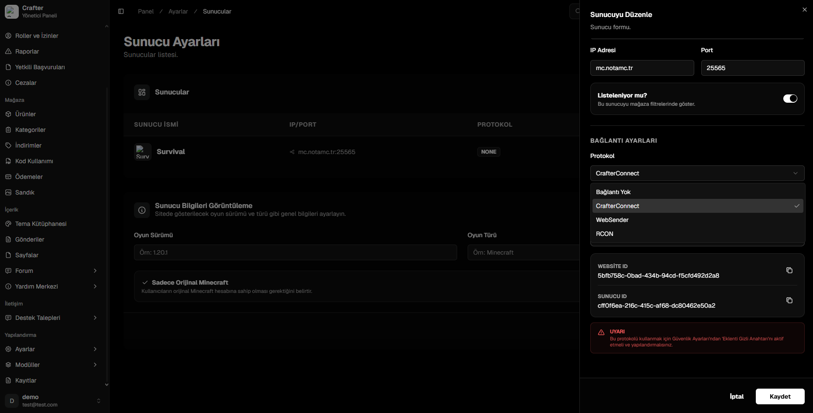
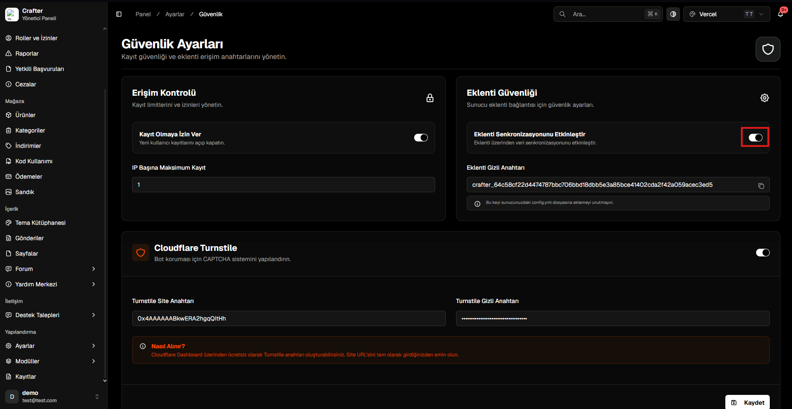
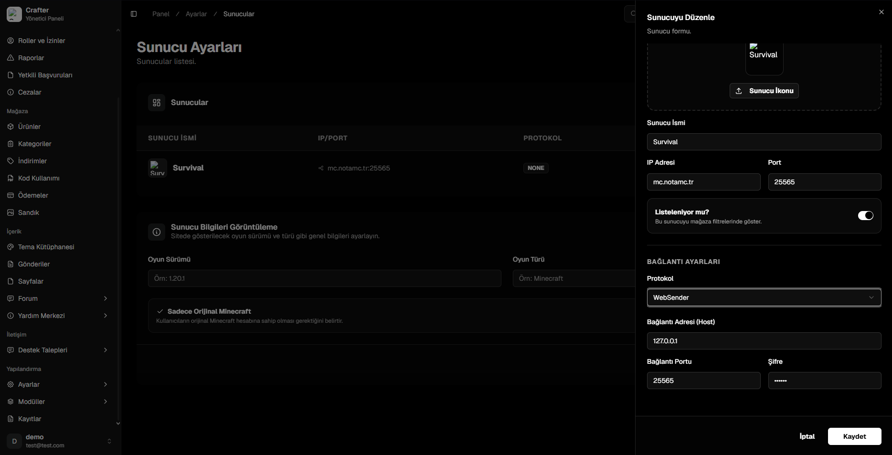

Crafter supports multiple high-performance protocols to facilitate command dispatching and real-time player data synchronization between your website and Minecraft servers.

<Tabs>
  <Tab title="CrafterConnect (Recommended)">
    <Note>
      With **CrafterConnect 2.0**, setup uses a connection code (`/crafter connect`); no manual configuration is needed. Details: [CrafterConnect plugin](/en/developers/crafterconnect). The steps below are for plugin versions older than 2.0.
    </Note>

    <Tip>
      **Most Stable & Secure Option:** Purpose-built for Spigot, Paper, Purpur, and Velocity proxies. Delivers zero-latency execution and secure WebSocket synchronization without opening external firewall ports.
    </Tip>

    <Steps>
      <Step title="Download the Plugin">
        Download the latest `CrafterConnect.jar` from [GitHub Releases](https://github.com/Crafter-CMS/CrafterConnect/releases/latest) and place it into your server's `plugins/` directory.
      </Step>
      <Step title="Obtain Website & Server ID">
        1. Navigate to [Dashboard \> Servers](https://app.crafter.net.tr/en/dashboard/settings/servers).
        2. Create a new server or click **Edit** on an existing server.
        3. Copy the **Website ID** and **Server ID** values.

        <Frame caption="Copy Website ID and Server ID from Server Settings">
          
        </Frame>

        <Note>
          When registering a new server, the `Server ID` is generated immediately after saving.
        </Note>
      </Step>
      <Step title="Generate Plugin Secret Key">
        1. Open the [Dashboard \> Security](https://app.crafter.net.tr/en/dashboard/settings/security) tab.
        2. Toggle on **Enable Plugin Synchronization** and save settings.
        3. Copy your unique `Plugin Secret Key`.

        <Frame caption="Enable plugin sync and copy the Secret Key from Security Settings">
          
        </Frame>
      </Step>
      <Step title="Configure config.yml">
        Start your server once to generate `plugins/CrafterConnect/config.yml`, open it, and paste your values:

        ```yaml config.yml
        # CrafterConnect Configuration File
        
        # API Settings
        api-url: "api.crafter.net.tr"
        website-id: "ENTER_WEBSITE_ID_HERE"
        plugin-secret: "ENTER_PLUGIN_SECRET_HERE"
        
        # Server ID (Must match the server ID in your dashboard)
        server-id: "ENTER_SERVER_ID_HERE"
        
        # Language (en, tr)
        language: "en"
        
        # Advanced Settings
        reconnect-delay-seconds: 5
        ping-interval-seconds: 30
        debug-mode: false
        use-ssl: true
        ```

        Restart your server. You will see a successful connection message in your server console.
      </Step>
    </Steps>
  </Tab>
  <Tab title="RCON">
    Execute console commands using Minecraft's native Remote Console protocol without external plugins.

    <Steps>
      <Step title="Configure server.properties">
        Enable RCON parameters in your server's root `server.properties` file:

        ```properties server.properties
        enable-rcon=true
        rcon.port=25575
        rcon.password=YourStrongPassword123!
        ```
      </Step>
      <Step title="Add Server in Crafter Dashboard">
        Navigate to [Dashboard \> Servers](https://app.crafter.net.tr/en/dashboard/settings/servers), set protocol to **RCON**, and fill in the connection credentials:

        - **IP Address:** Server public IP
        - **Port:** `rcon.port` (Default: `25575`)
        - **Password:** Configured `rcon.password`

        <Frame caption="RCON Connection Setup Interface">
          
        </Frame>
      </Step>
    </Steps>
  </Tab>
  <Tab title="WebSender">
    Integrate via the legacy WebSender plugin.

    <Steps>
      <Step title="Obtain WebSender Credentials">
        Note down the port and password specified in your server's `plugins/WebSender/config.yml`.
      </Step>
      <Step title="Register in Dashboard">
        Set protocol to **Websender** and enter IP, Port, and Password.

        <Frame caption="WebSender Connection Interface">
          
        </Frame>
      </Step>
    </Steps>
  </Tab>
</Tabs>
