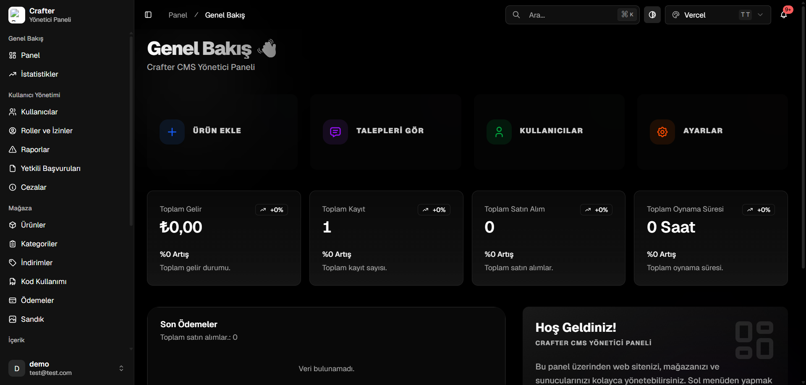

<Frame>
  
</Frame>

## Welcome to Crafter!

Are you ready to take your gaming community and Minecraft server to the next level? **Crafter** is a licensed SaaS CMS platform featuring modern open-source themes, seamless server management, and automated store delivery. Elevate your server operations with high performance and elegant design.

<CardGroup cols={2}>
  <Card title="Default Crafter Theme" icon="code-branch" href="https://github.com/EfeSorogluu/Crafter-Default-Theme">
    Contribute to development and explore open-source theme repositories on GitHub.
  </Card>

  <Card title="Join the Community" icon="comments" href="https://discord.crafter.net.tr/">
    Join our Discord server to get real-time updates and collaborate with the community.
  </Card>
</CardGroup>

## Core Features

Crafter provides all the essential tools you need to build and scale your gaming network:

<CardGroup cols={2}>
  <Card title="Player & User Management" icon="users" href="/en/web-features/user-management/users">
    Effortlessly manage player accounts, roles, permissions, and audit logs.
  </Card>

  <Card title="Store & Payment Systems" icon="store" href="/en/web-features/store/products">
    Monetize your server with automated product delivery and built-in virtual POS gateways.
  </Card>

  <Card title="Modern & Ultra-Fast UI" icon="bolt" href="/en/web-features/content/theme-library">
    Built on Next.js with lightning-fast page transitions and full mobile responsiveness.
  </Card>

  <Card title="Effortless Cloud Setup" icon="rocket" href="/en/quickstart">
    Fully cloud-hosted infrastructure allows you to launch your web platform in minutes.
  </Card>
</CardGroup>

## Live Demo

Explore Crafter in action:

- Official Website: [crafter.net.tr](https://crafter.net.tr)
- Live Demo: [demo.crafter.net.tr](https://demo.crafter.net.tr)
  - Username: `demo`
  - Password: `demo`
