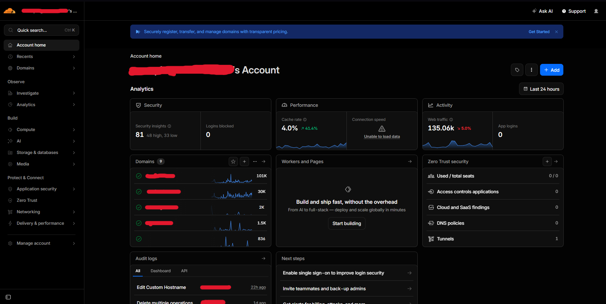
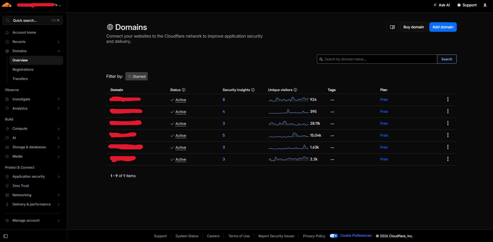
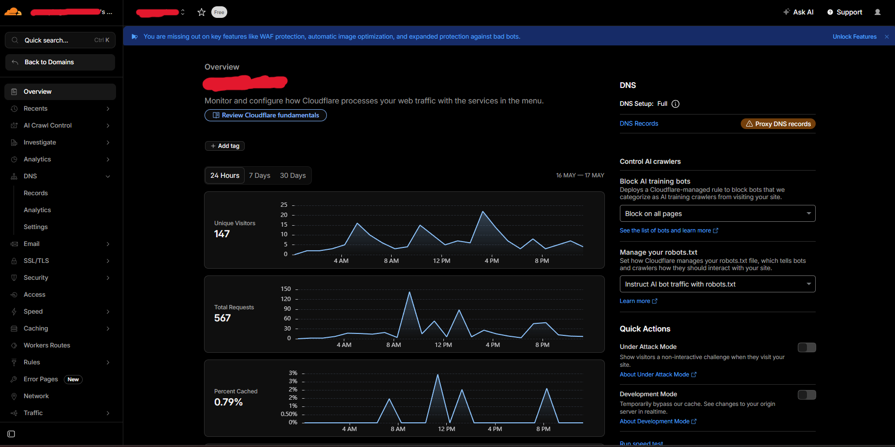
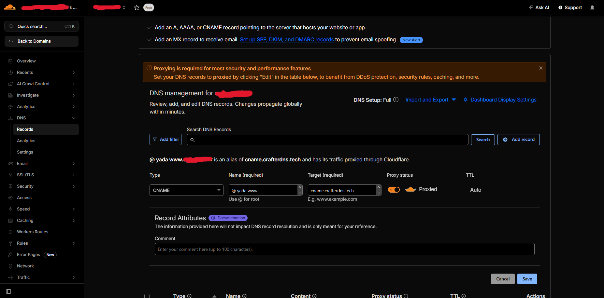
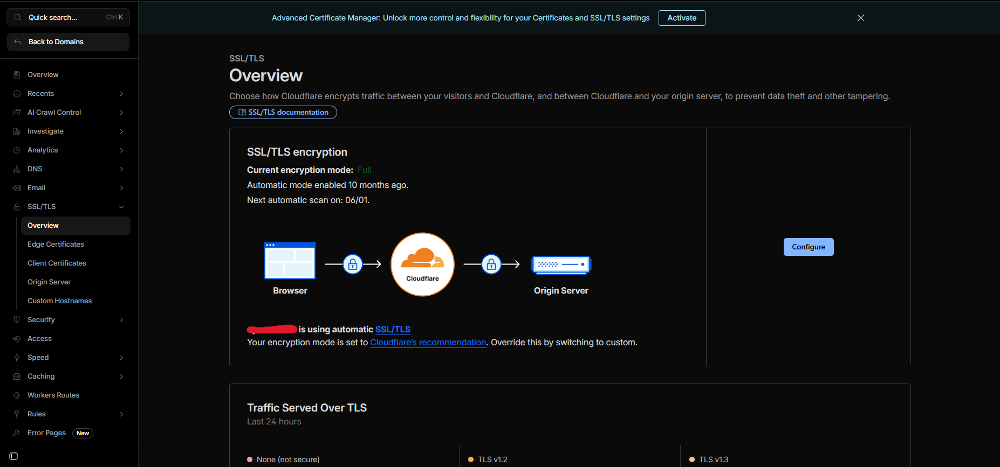

## Setup Steps

Follow the instructions below to connect your custom domain and start using Crafter CMS.

---

## Step 1: Purchase Your Domain Name

Purchase a domain name from any registrar of your choice (e.g., Namecheap, GoDaddy, Google Domains). Example: `yourdomain.com`

<Note>
  If you already own a domain name, you can skip this step.
</Note>

---

## Step 2: Sign In to Cloudflare

Navigate to [cloudflare.com](https://www.cloudflare.com/) and click **Log in** at the top right corner.

<Note>
  If you do not have a Cloudflare account, click **Sign up** to create a free account.
</Note>

<Frame>
  
</Frame>

---

## Step 3: Connect Your Domain to Crafter

After signing in to Cloudflare, select **Websites** (or **Domains**) from the left sidebar and click **Overview**.

<Note>
  Ensure your domain’s nameservers are pointed to Cloudflare.
</Note>

<Frame>
  
</Frame>

Select the domain associated with your active Crafter license.

<Frame>
  
</Frame>

From the left sidebar, click **DNS** and then **Records**.

Click **Add record** and fill in the required fields:

- **Type:** `CNAME`
- **Name (required):** `@` (or subdomain)
  <Note>
    For `www` redirects, configure a Page Rule / Redirect rule pointing `www` to `@`.
  </Note>
- **Target (required):** `cname.crafterdns.tech`
- **Proxy status:** Proxied (Orange cloud on)
- **TTL:** Auto

<Frame>
  
</Frame>

After configuring the record, click **Save**.

<Note>
  If you have an existing conflicting `A` record for `@`, remove or update it to avoid DNS resolution errors.
</Note>

Next, navigate to **SSL/TLS** in the left menu and select **Overview**.

<Frame>
  
</Frame>

Set the encryption mode to **Full** (or **Flexible** depending on your setup) and save your changes. Your Crafter CMS website is now live!
