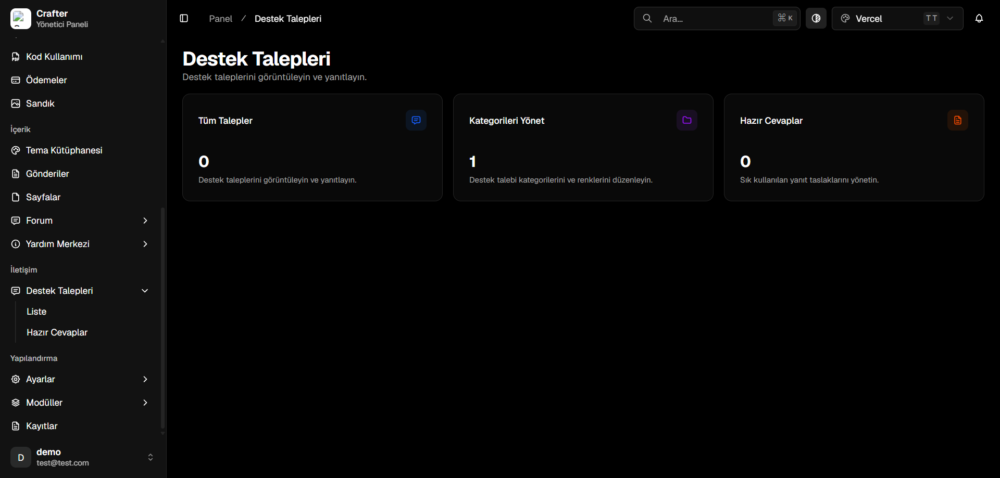
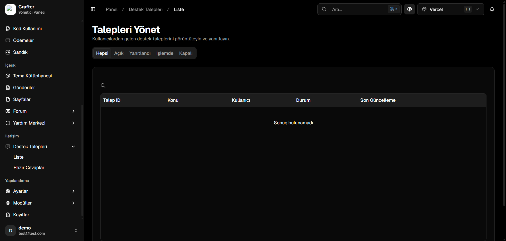
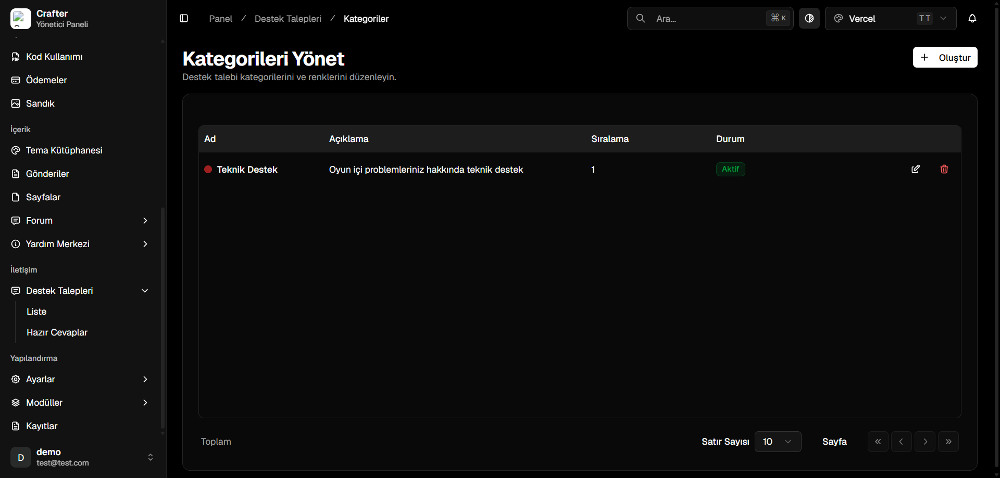
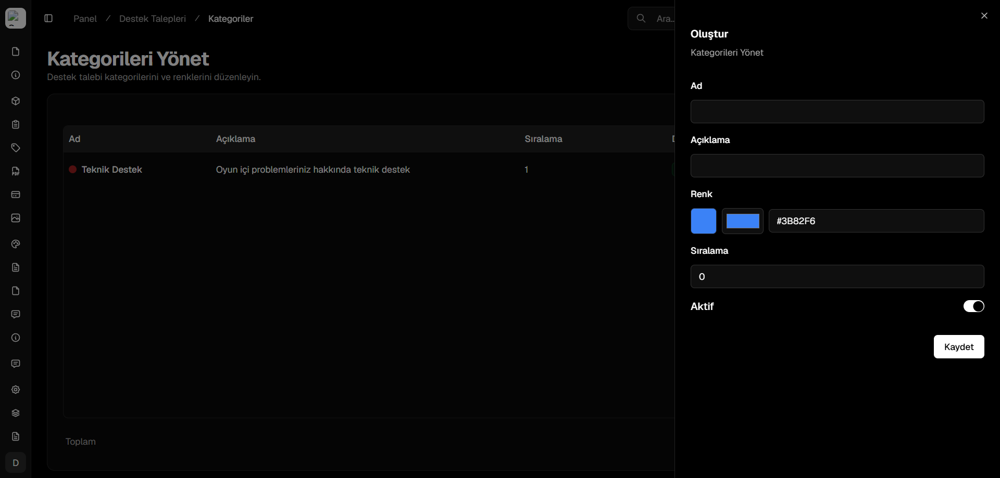

The Crafter Ticket Management module provides a unified helpdesk workflow for your staff team to resolve player inquiries, account disputes, and payment tickets.

Navigate to [Dashboard \> Tickets](https://app.crafter.net.tr/tr/dashboard/tickets) to inspect support queues.

<Frame caption="Support Tickets Dashboard Overview">
  
</Frame>

---

## Quick Navigation & Overview

- **All Tickets:** Total volume of support requests with instant list filtering.
- **Manage Categories:** Organize tickets into colored departments (Technical Support, Billing, Bug Reports).
- **Canned Responses:** Manage pre-written macro responses for rapid resolution.

---

## Managing & Filtering Tickets

Inspect all tickets at [Dashboard \> Tickets \> List](https://app.crafter.net.tr/tr/dashboard/tickets/list).

<Frame caption="Tickets List Interface">
  
</Frame>

### Status Filters

- **All:** Full ticket repository.
- **Open:** Newly created requests awaiting first staff reply.
- **Answered:** Staff responded; awaiting player feedback.
- **In Progress:** Under active investigation.
- **Closed:** Resolved inquiries.

---

## Ticket Categories & Departments

Color-code departments for easy triage at [Dashboard \> Tickets \> Categories](https://app.crafter.net.tr/tr/dashboard/tickets/categories).

<Frame caption="Ticket Categories Interface">
  
</Frame>

### Creating a Category

<Steps>
  <Step title="Open Creator">
    Click **+ Create** on the Categories page.
  </Step>
  <Step title="Configure Properties">
    - **Name:** Title (e.g., _Billing Inquiries_, _Bug Reports_).
    - **Description:** Purpose and scope.
    - **Color:** HEX accent color (e.g., `#3B82F6`).
    - **Sort Order:** Priority index.
    - **Active:** Publish toggle.
  </Step>
  <Step title="Save">
    Click **Save** to activate.
  </Step>
</Steps>

<Frame caption="Category Creator Drawer">
  
</Frame>
