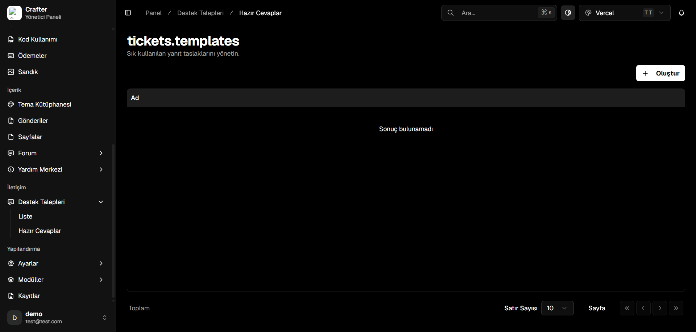
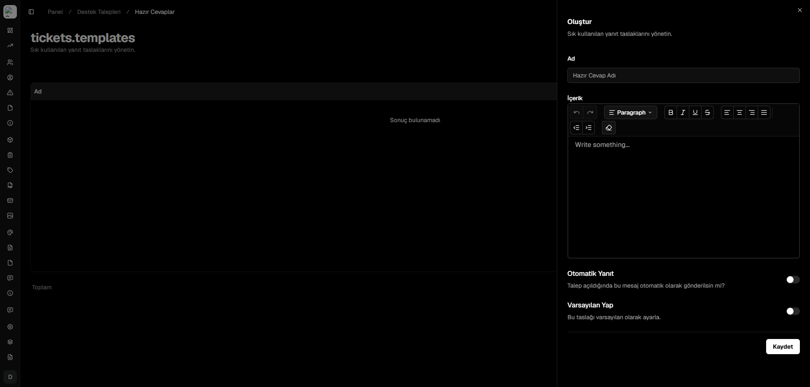

The Crafter Canned Responses module empowers support agents to deliver quick, consistent answers to repetitive questions and standard operating procedures.

Navigate to [Dashboard \> Tickets \> Templates](https://app.crafter.net.tr/tr/dashboard/tickets/templates) to manage template macros.

<Frame caption="Canned Responses Overview">
  
</Frame>

---

## Creating a Response Template

<Steps>
  <Step title="Open Template Creator">
    Click **+ Create** in the top right corner.
  </Step>
  <Step title="Configure Template Content">
    - **Name:** Title or internal label (e.g., _Payment Confirmation Greeting_, _Technical Investigation Initial Reply_).
    - **Content:** Rich text message formatted with bullet points, links, and bold highlights.
    - **Auto-Reply:** Toggle on if this response should automatically send upon ticket creation.
    - **Make Default:** Set as the default pre-filled macro for staff members.
  </Step>
  <Step title="Save Template">
    Click **Save** to enable the macro across your team.
  </Step>
</Steps>

<Frame caption="Template Creator Drawer">
  
</Frame>
