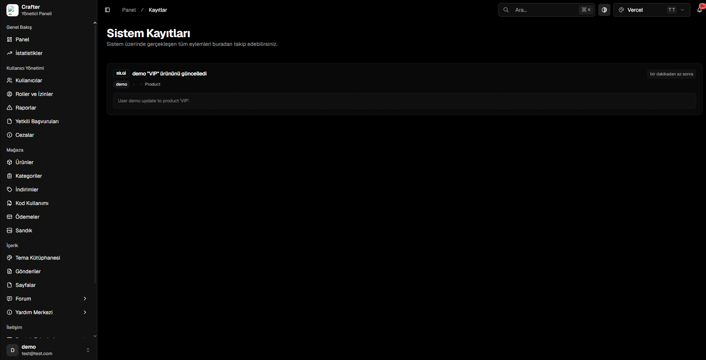

Crafter Audit Logs record every login, store transaction, credit transfer, administrative modification, and security alert across your network.

Navigate to [Dashboard \> Logs](https://app.crafter.net.tr/en/dashboard/logs) to inspect real-time system logs.

<Frame caption="Audit Logs Inspection Interface">
  
</Frame>

---

## 1. Anatomy of an Audit Record

- **Log Type (`LOG_TYPES`):** Specific event code (e.g., `purchase_product`, `update_product`, `ban_user`).
- **Category (`LOG_CATEGORIES`):** Parent module (`payment`, `user`, `auth`, `product`, `ticket`).
- **Performed By (`performedBy`):** Account username or `SYSTEM`.
- **Description & Message:** Plain-language summary.
- **Event Data (`eventData`):** Technical JSON payload containing before/after values.
- **Timestamp:** Exact execution time.

---

## 2. Severity Levels

<CardGroup cols={2}>
  <Card title="INFO" color="#3b82f6" icon="circle-info">
    Standard operational reads and normal user actions.
  </Card>

  <Card title="SUCCESS" color="#16a34a" icon="circle-check">
    Successful store orders, registrations, and credit top-ups.
  </Card>

  <Card title="WARNING" color="#f59e0b" icon="triangle-exclamation">
    Administrative edits, player bans, and deletions.
  </Card>

  <Card title="ERROR" color="#ef4444" icon="circle-xmark">
    Failed payment attempts, unauthorized access attempts, and security blocks.
  </Card>
</CardGroup>

---

## 3. Log Categories (`LOG_CATEGORIES`)

Logs are organized across 16 core categories: `auth`, `user`, `payment`, `product`, `category`, `chest`, `role`, `server`, `ticket`, `post`, `forum`, `help_center`, `coupon`, `redeem_code`, `staff_form`, and `config`.
