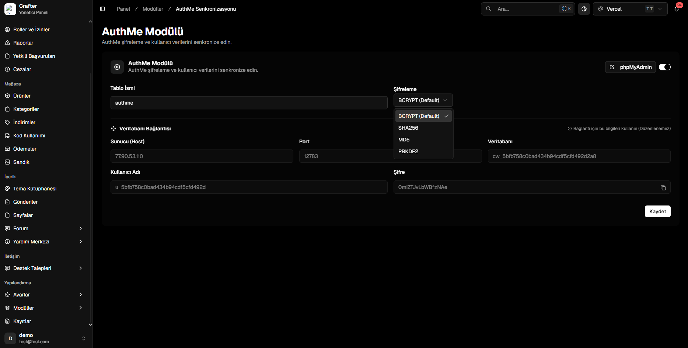

The Crafter AuthMe module synchronizes in-game player registrations from **AuthMeReloaded** with your web platform's user database, allowing unified account credentials across both web and server.

Navigate to [Dashboard \> Modules \> AuthMe](https://app.crafter.net.tr/tr/dashboard/modules/authme) to configure the bridge.

<Frame caption="AuthMe Module Configuration Interface">
  
</Frame>

---

## Setup & Configuration

<Steps>
  <Step title="Enable Module">
    Toggle on the module switch in the top right corner.
  </Step>
  <Step title="Select Password Hashing Algorithm">
    - **Table Name:** Table identifier (default: `authme`).
    - **Password Hash:** Choose `BCRYPT` (Recommended).
  </Step>
  <Step title="Update AuthMe config.yml">
    Configure MySQL parameters in `plugins/AuthMe/config.yml`:

    ```yaml config.yml
    DataSource:
      backend: 'MYSQL'
      mySQLHost: '77.90.53.110'
      mySQLPort: '12783'
      mySQLDatabase: 'cw_your_database'
      mySQLUsername: 'u_your_username'
      mySQLPassword: 'YourPassword'
      mySQLTableName: 'authme'
    
    security:
      passwordHash: 'BCRYPT'
    ```
  </Step>
  <Step title="Save and Reload">
    Save in the dashboard and run `/authme reload` on your Minecraft server.
  </Step>
</Steps>
