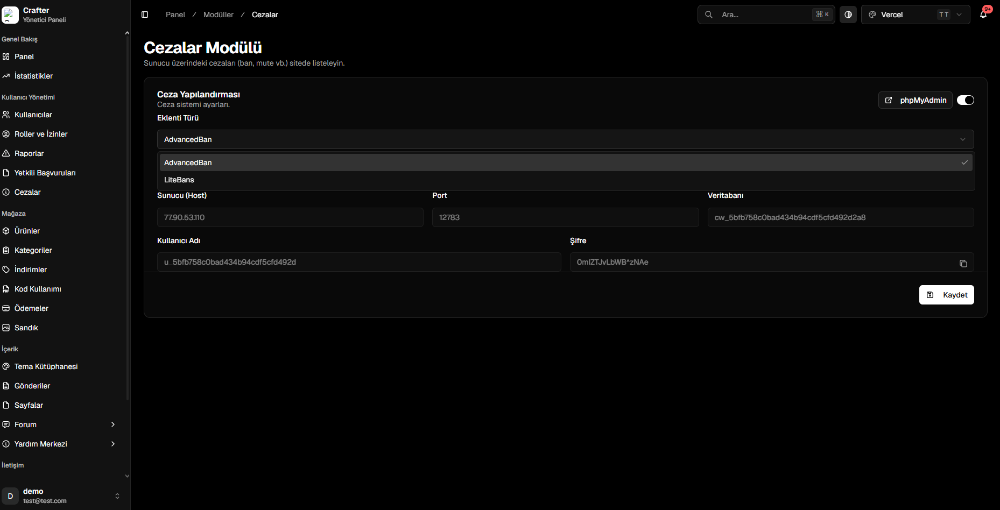

The Crafter Punishments configuration module connects your Minecraft server moderation plugins with the web platform via a dedicated MySQL database.

Navigate to [Dashboard \> Modules \> Punishments](https://app.crafter.net.tr/tr/dashboard/modules/punishments) to configure database settings.

<Frame caption="Punishments Module Interface">
  
</Frame>

---

## Configuration Steps

<Steps>
  <Step title="Enable Module">
    Toggle on the module switch and choose `AdvancedBan` or `LiteBans`.
  </Step>
  <Step title="Copy Database Credentials">
    Note down the generated Host, Port, Database name, Username, and Password.
  </Step>
  <Step title="Update Plugin config.yml">
    Paste the MySQL credentials into your server's plugin configuration file.
  </Step>
  <Step title="Reload Server Plugin">
    Execute `/litebans reload` or `/advancedban reload` in console.
  </Step>
</Steps>
