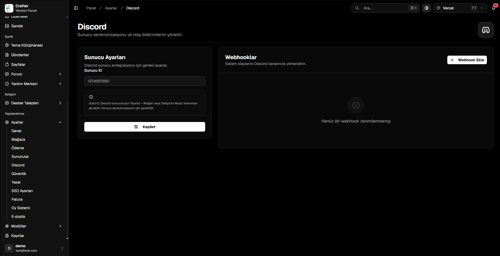
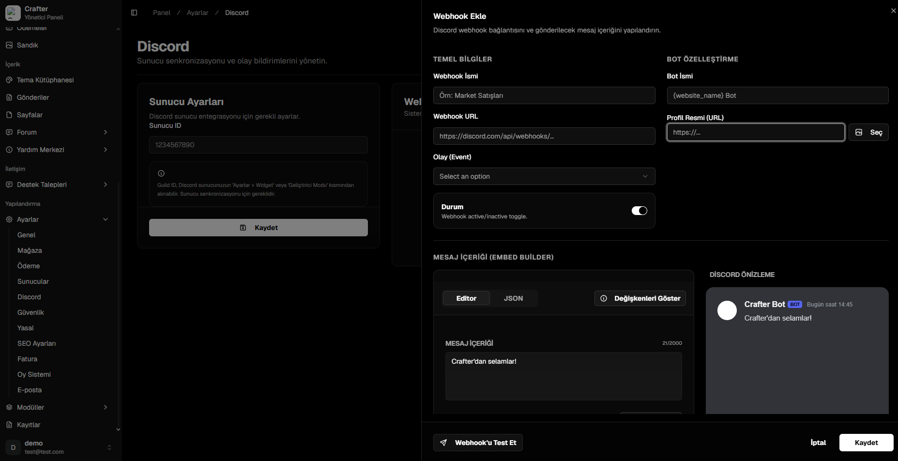
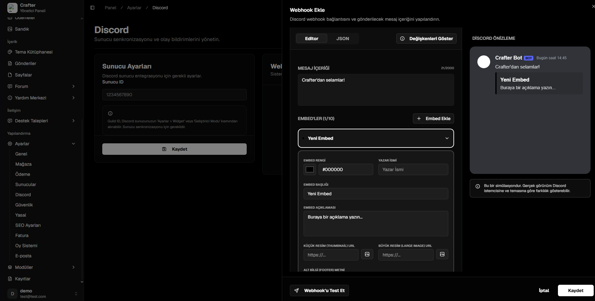

The Crafter CMS Discord module enables automated real-time alerts for store purchases, credit top-ups, new registrations, tickets, and forum activity sent as rich embeds directly into your Discord channels.

Navigate to [Dashboard \> Settings \> Discord](https://app.crafter.net.tr/tr/dashboard/settings/discord) to link your server ID and configure webhook alerts.

<Frame caption="Discord Settings & Webhooks Panel">
  
</Frame>

---

## 1. Discord Server (Guild ID) Setup

- **Guild ID:** Right-click your Discord server icon (with Developer Mode enabled) and copy your **Server ID**, then paste and save it to enable widget synchronization.

---

## 2. Adding a Webhook Alert

<Steps>
  <Step title="Open Webhook Drawer">
    Click **+ Add Webhook** in the top right corner.
  </Step>
  <Step title="Configure Webhook Endpoint">
    - **Webhook Name:** Internal label (e.g., `Store Purchases`, `Support Tickets`).
    - **Webhook URL:** Destination URL copied from Discord channel integrations.
    - **Event:** Trigger event (e.g., `purchase_product`, `balance_load_success`, `create_ticket`).
    - **Active:** Enable toggle.
  </Step>
  <Step title="Customize Bot Avatar & Username">
    - **Bot Username:** Custom display name (e.g., `{website_name} Bot`).
    - **Avatar URL:** Image link for bot profile picture.
  </Step>
</Steps>

<Frame caption="Webhook Creator & Bot Persona">
  
</Frame>

---

## 3. Dynamic Variables (Placeholders)

Use `{variable}` placeholders inside embed titles, bodies, and footer texts:

| Placeholder | Description | Example Output |
| :-- | :-- | :-- |
| `{username}` | Triggering player's username | `Steve` |
| `{website_name}` | Configured website name | `Crafter Network` |
| `{website_url}` | Platform URL | `https://yourdomain.com` |
| `{product_name}` | Store product purchased | `VIP+` |
| `{price}` / `{amount}` | Transaction value | `15.00` |
| `{currency}` | Currency symbol | `$`, `€`, `₺` |
| `{ticket_title}` | Ticket subject | `Issue with Top-up` |
| `{ticket_id}` | Unique ticket ID | `CRF-9821` |

---

## 4. Visual Embed Builder

<Frame caption="Embed Designer & Live Preview">
  
</Frame>

<Tip>
  Click **Test Webhook** to dispatch a trial payload to your Discord channel and verify formatting before saving.
</Tip>
