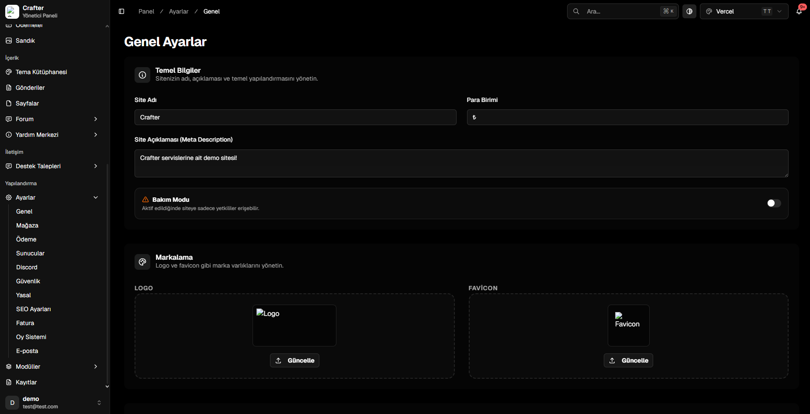
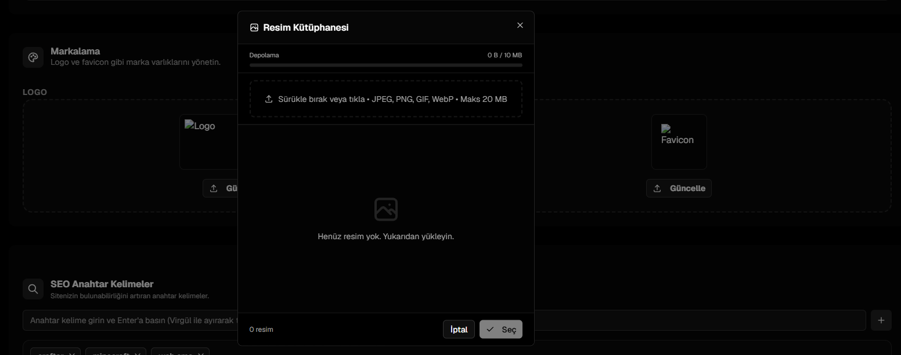

The Crafter CMS General Settings page allows you to configure your web platform's site name, global meta description, primary currency, maintenance mode, and branding assets.

Navigate to [Dashboard \> Settings \> General](https://app.crafter.net.tr/tr/dashboard/settings/general) to modify global preferences.

<Frame caption="General Settings Panel">
  
</Frame>

---

## 1. Core Identity & Currency

- **Site Name:** Title displayed on browser tabs, search engine results, and email receipts (e.g., `Crafter Network`).
- **Currency Symbol:** Primary monetary symbol used throughout the store, cart, and top-up modules (e.g., `$`, `€`, `₺`).
- **Site Description (Meta Description):** Brief tagline summary for search engines and social card previews.

---

## 2. Maintenance Mode

Use Maintenance Mode when upgrading themes, editing servers, or performing backend migrations:

<Warning>
  **Maintenance Mode Behavior:** Regular visitors will encounter a branded Maintenance page. Administrators and staff with dashboard permissions retain full access to test and preview the website.
</Warning>

- **Maintenance Mode (Toggle):** Flip the switch on to lock down the frontend, or toggle off to restore public access instantly.

---

## 3. Brand Assets (Logo & Favicon)

<Steps>
  <Step title="Upload Site Logo">
    Click **Update** on the **LOGO** card to select your primary brand logo shown in theme headers and notification emails.
  </Step>
  <Step title="Upload Favicon">
    Click **Update** on the **FAVICON** card to upload a square icon (`.png` or `.ico`) for browser tabs and mobile bookmarks.
  </Step>
</Steps>

<Frame caption="Branding, Logo and Favicon Settings">
  
</Frame>

<Tip>
  For optimal fidelity, use transparent `.png` or `.svg` files for your logo, and square 32x32px or 64x64px images for your favicon.
</Tip>
