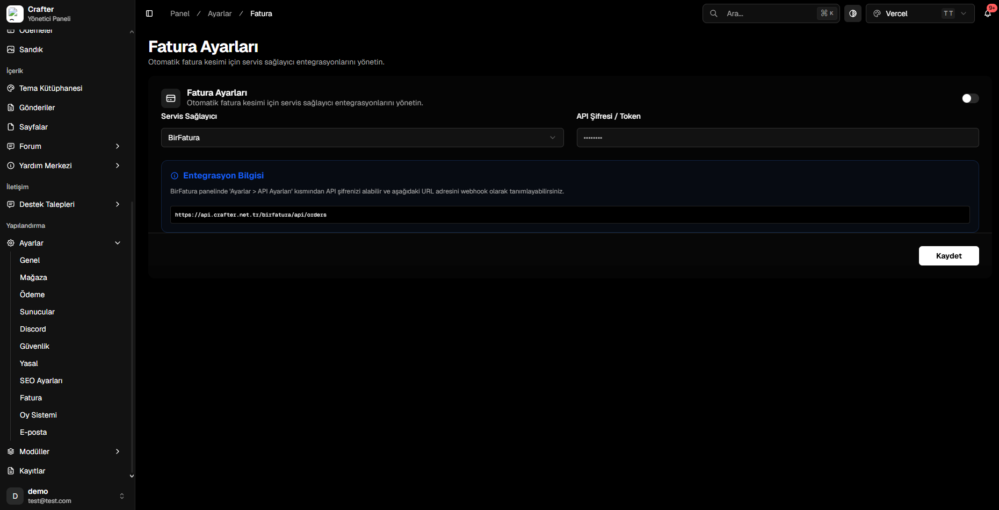

The Crafter CMS Invoice module enables automated e-invoice and legal e-archive generation for all store transactions and credit top-ups through service integrations like BirFatura.

Navigate to [Dashboard \> Settings \> Invoice](https://app.crafter.net.tr/tr/dashboard/settings/invoice) to link your invoicing account.

<Frame caption="Invoicing & BirFatura Setup Interface">
  
</Frame>

---

## Setup & Configuration

<Steps>
  <Step title="Enable Invoicing Service">
    Toggle on the invoice service switch in the top right corner.
  </Step>
  <Step title="Select Service Provider">
    Choose `BirFatura` from the provider dropdown.
  </Step>
  <Step title="Paste API Token">
    Copy your secret API Token from your BirFatura dashboard and paste it into the **API Password / Token** field.
  </Step>
  <Step title="Configure Webhook Endpoint">
    Add the Crafter dispatch webhook URL to your provider panel:
    ```text
    https://api.crafter.net.tr/birfatura/api/orders
    ```
  </Step>
  <Step title="Save">
    Click **Save** to activate automatic billing.
  </Step>
</Steps>
