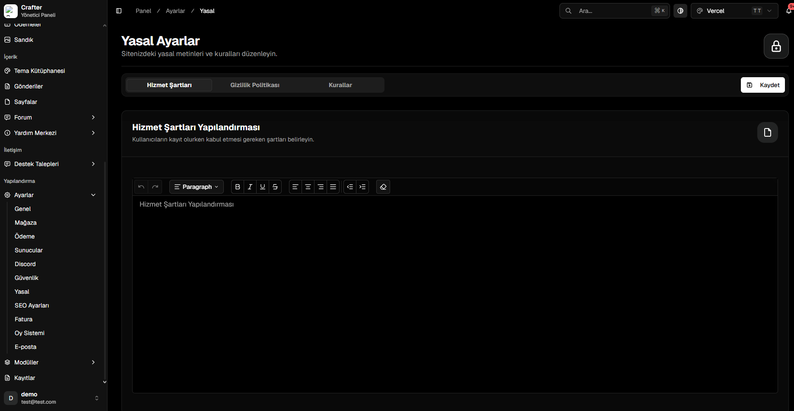

The Crafter CMS Legal Settings module centralizes all player agreements, GDPR / privacy policies, refund terms, and server rules in one easy-to-update interface.

Navigate to [Dashboard \> Settings \> Legal](https://app.crafter.net.tr/tr/dashboard/settings/legal) to update legal documents.

<Frame caption="Legal Agreements Management Panel">
  
</Frame>

---

## Managed Agreements

- **Terms of Service:** General platform usage conditions, checkout refund terms, and liability disclosures.
- **Privacy Policy:** Disclosures regarding player data handling, cookies, and privacy compliance.
- **Server Rules:** In-game behavior guidelines, griefing definitions, and disciplinary standards.

---

## Editing & Publishing

<Steps>
  <Step title="Select Document Tab">
    Choose **Terms of Service**, **Privacy Policy**, or **Server Rules** from the top tab navigation.
  </Step>
  <Step title="Format Body Text">
    Use the rich text editor to compose numbered clauses, bold highlights, and external policy links.
  </Step>
  <Step title="Save">
    Click **Save** to update public legal pages (`yourdomain.com/legal/...`) instantly.
  </Step>
</Steps>
