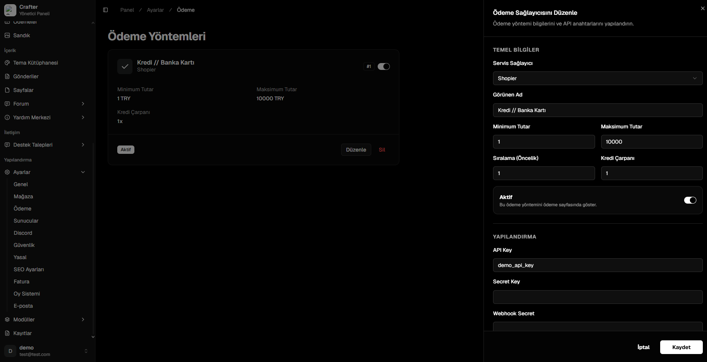

The Crafter CMS Payment Methods configuration page allows you to manage all checkout channels (Credit/Debit Card, Wire Transfer, Mobile Wallets), set transaction limits, and establish promotional bonus multipliers.

Navigate to [Dashboard \> Settings \> Payment](https://app.crafter.net.tr/tr/dashboard/settings/payment) to configure payment gateways.

<Frame caption="Payment Providers Management Interface">
  
</Frame>

---

## Gateway Parameters

### 1. General Properties

- **Service Provider:** Supported payment gateway (Shopier, İyzico, PayTR, Stripe, Tosla, XSolla).
- **Display Name:** Title shown on the checkout page (e.g., `Credit / Debit Card`, `International Cards`).
- **Minimum Amount:** Smallest allowed transaction value.
- **Maximum Amount:** Highest allowed transaction cap per checkout.
- **Sort Order:** Priority index determining placement order on the checkout screen.
- **Credit Multiplier (Bonus):** Define promotional bonus balance rates:
  - Standard rate is `1` (1x).
  - Set to `1.2` (1.2x) to grant 120 credits when a player pays 100 currency units.
- **Active (Toggle):** Instant visibility switch.

---

### 2. API Credentials & Security

Enter the API keys provided by your payment gateway:

- **API Key / Merchant ID**
- **Secret Key / Password**
- **Webhook Secret / Salt**
