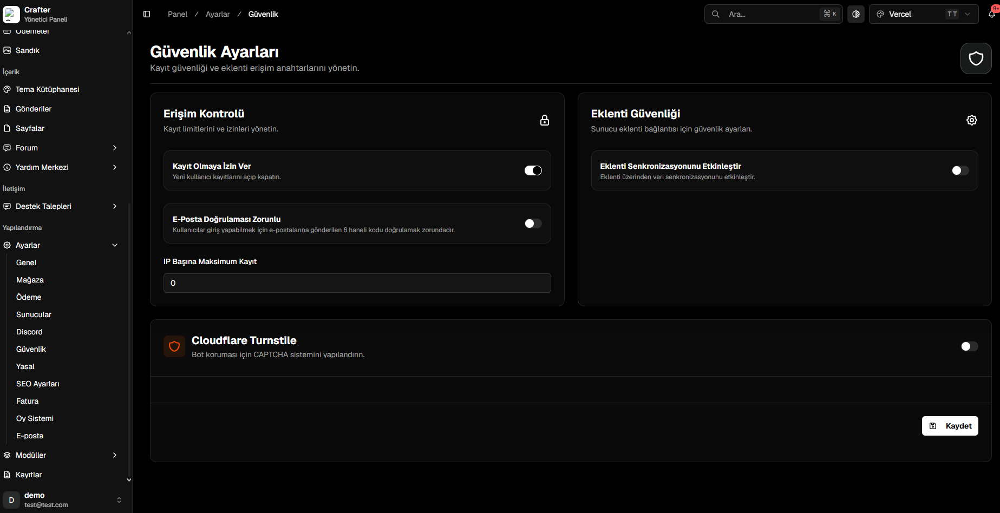

The Crafter CMS Security Settings module allows you to configure player registration policies, prevent spam bot registrations, and secure communication channels between your game servers and Crafter plugins.

Navigate to [Dashboard \> Settings \> Security](https://app.crafter.net.tr/tr/dashboard/settings/security) to manage security rules.

<Frame caption="Security Settings Panel">
  
</Frame>

---

## 1. Access Control (Registration Policies)

- **Allow Registration (Toggle):** Instantly enable or lock new user account registrations.
- **Require Email Verification (Toggle):** Mandate 6-digit confirmation codes sent to the player's email before granting login access.
- **Max Registrations Per IP:** Limit maximum accounts that can be registered from a single IP address (`0` for unlimited).

---

## 2. Plugin Security (CrafterConnect)

- **Enable Plugin Synchronization (Toggle):** Must be enabled for `CrafterConnect` and official plugins to synchronize commands and data with the website.
- When disabled, all external incoming plugin API requests are immediately blocked.

<Tip>
  For detailed plugin installation and token configuration steps, review our [Minecraft Server Setup Guide](/en/game-servers/minecraft).
</Tip>

---

## 3. Cloudflare Turnstile (Bot Protection)

Protects all forms (Registration, Login, Applications) with invisible, privacy-first CAPTCHA.

- **Cloudflare Turnstile (Toggle):** Enable bot protection.
- Paste your **Site Key** and **Secret Key** generated from your Cloudflare dashboard.

<Card title="Cloudflare Turnstile Setup Walkthrough" icon="shield-halved" href="/en/integrations/cloudflare-turnstile">
  Read the step-by-step guide on creating Turnstile widgets and obtaining API keys.
</Card>
