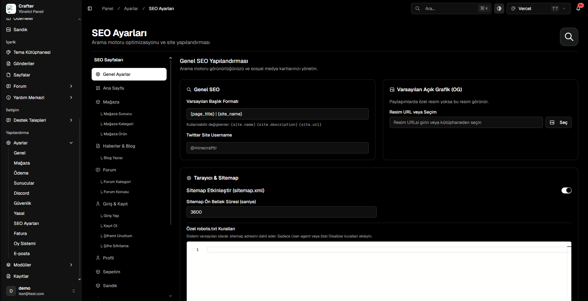
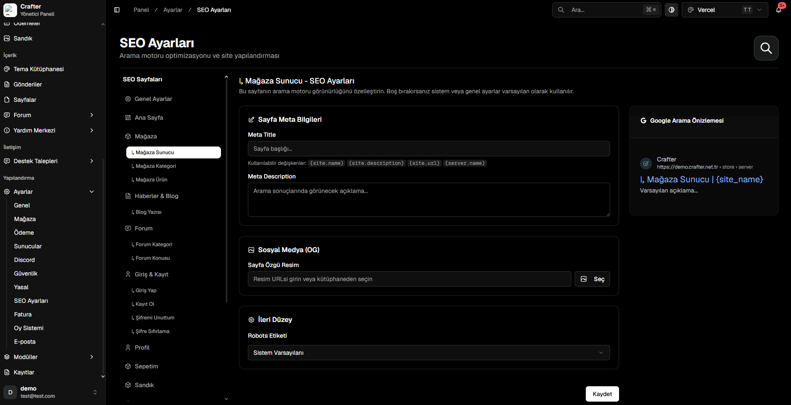

The Crafter SEO Management module maximizes your website's search engine indexing, configures Open Graph cards for rich Discord / Twitter embeds, and supports dynamic template placeholders.

Navigate to [Dashboard \> Settings \> SEO](https://app.crafter.net.tr/tr/dashboard/settings/seo) to configure metadata.

<Frame caption="Global SEO Configuration Interface">
  
</Frame>

---

## 1. Global Defaults

- **Default Title Pattern:** Standard page title pattern (e.g., `{page_title} | {site_name}`).
- **Twitter Handle:** Twitter/X account tagged in shared links (e.g., `@CrafterNetwork`).
- **Default OG Image:** Fallback preview banner when no specific page image is assigned.

---

## 2. XML Sitemap & Crawlers

- **Enable XML Sitemap:** Generates dynamic XML feeds for Google at `yourdomain.com/sitemap.xml`.
- **Sitemap Cache Duration:** Invalidation cache lifetime in seconds (e.g., `3600`).
- **Custom robots.txt Rules:** Specify crawl directives and crawler rules.

---

## 3. Page-Specific SEO & Live Google Preview

Customize meta tags for individual sections (Home, Store, Blog, Forum, Login, Profile, Cart, Chest):

<Frame caption="Page-Specific SEO & Live Google SERP Simulation">
  
</Frame>

---

## 4. Dynamic SEO Placeholders

| Variable | Description |
| :-- | :-- |
| `{site.name}` | Configured website name |
| `{site.description}` | Global description |
| `{product.name}` | Product title |
| `{product.price}` | Product price |
| `{category.name}` | Category title |
| `{post.title}` | Blog/article headline |
| `{topic.title}` | Forum thread subject |
| `{user.name}` | Player username |
