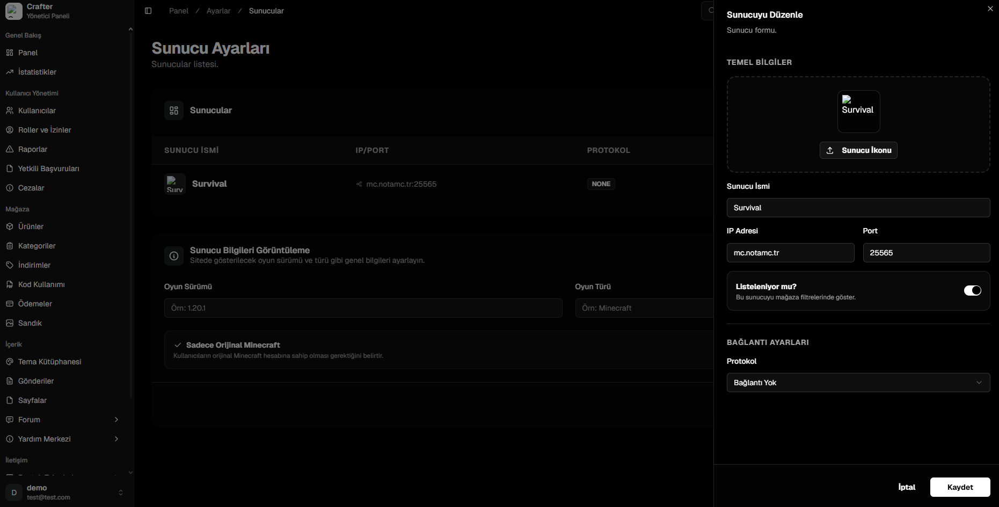

The Crafter Server Settings module allows you to register all realms and subservers in your network (Survival, Skyblock, Factions, etc.), display online player metrics, and configure instant command dispatch protocols.

Navigate to [Dashboard \> Settings \> Servers](https://app.crafter.net.tr/tr/dashboard/settings/servers) to manage your server network.

<Frame caption="Server Configuration Management Interface">
  
</Frame>

---

## Server Properties

### 1. General Info

- **Server Icon:** Subserver logo/icon shown in store filter dropdowns.
- **Server Name:** Display title (e.g., `Survival 1.20`, `Hardcore Skyblock`).
- **IP Address & Port:** Direct connection endpoint (e.g., `play.yourdomain.com:25565`).
- **Listed in Store (Toggle):** Enables filtering by this realm on the web store.

---

### 2. Connection Protocols

<Tabs>
  <Tab title="CrafterConnect (Recommended)">
    Official secure two-way WebSocket bridge plugin.

    - **Requirements:** Install `CrafterConnect.jar` into your server's `plugins/` directory.
    - **Benefits:** No port forwarding required; zero-latency command delivery; reliable chest sync.
    - **Setup:** Paste the Website ID, Server ID, and Plugin Secret Key into `config.yml`.
  </Tab>
  <Tab title="RCON">
    Native Minecraft Remote Console protocol.

    - **Requirements:** Enable RCON in `server.properties` (`enable-rcon=true`, set `rcon.port` and `rcon.password`).
    - **Setup:** Enter your public IP, RCON port, and password in the dashboard.
  </Tab>
  <Tab title="WebSender">
    Legacy Bukkit/Spigot WebSender plugin integration.

    - **Requirements:** `WebSender.jar` installed with open web port.
    - **Setup:** Enter WebSender port and password credentials.
  </Tab>
  <Tab title="None (Showcase Only)">
    For realms without command execution (informational display only).
  </Tab>
</Tabs>

<Card title="Minecraft Server Setup Walkthrough" icon="book-open" href="/en/game-servers/minecraft">
  Read the complete step-by-step setup guide for `CrafterConnect` and RCON configurations.
</Card>
