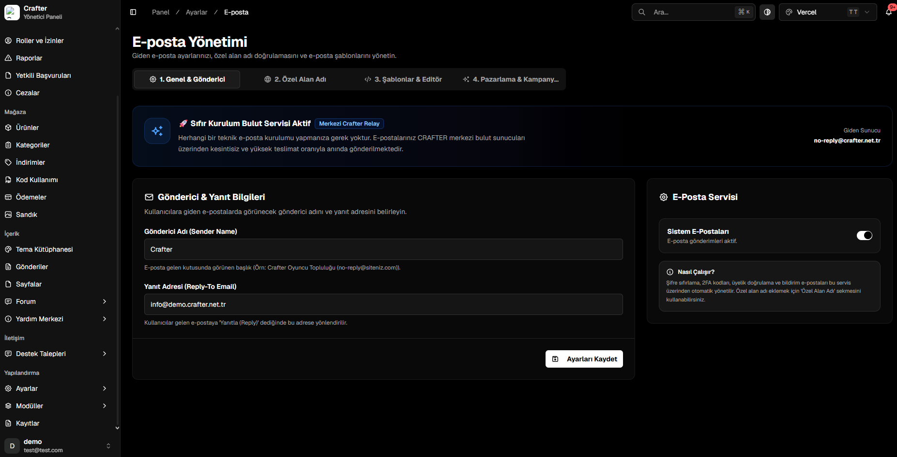
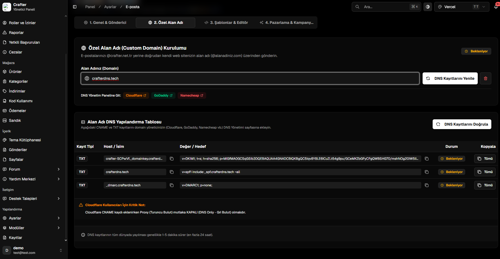
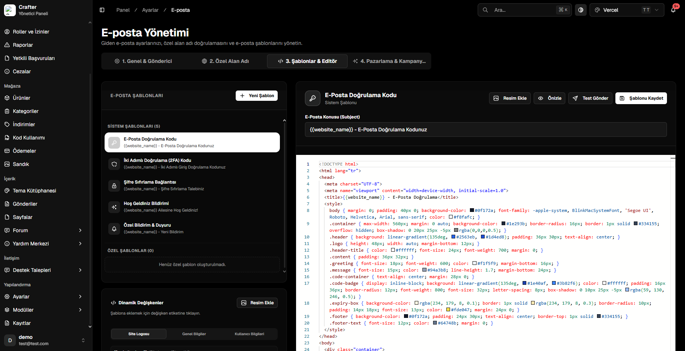

Crafter Email Management eliminates complex SMTP server setups by offering a built-in zero-configuration cloud relay along with custom domain DKIM/SPF verification.

Navigate to [Dashboard \> Settings \> Mailing](https://app.crafter.net.tr/tr/dashboard/settings/mailing) to manage outbound emails.

---

## 1. General & Sender Information

Crafter includes **Zero-Config Cloud Relay** enabled by default. System notifications (passwords, 2FA, welcome emails) deliver immediately from `no-reply@crafter.net.tr`.

<Frame caption="Sender Profile Panel">
  
</Frame>

- **Sender Name:** Header name on incoming emails (e.g., `Crafter Gaming Network`).
- **Reply-To Email:** Inquiries destination (e.g., `support@yourdomain.com`).

---

## 2. Custom Domain (DNS Verification)

To send emails directly from your own domain without running mail servers, add DNS verification records:

<Steps>
  <Step title="Add Domain">
    Enter your root domain (e.g., `yourdomain.com`) in the **Custom Domain** tab.
  </Step>
  <Step title="Add DNS TXT Records">
    Insert the provided **DKIM**, **SPF**, and **DMARC** TXT records into your DNS provider (Cloudflare, Namecheap, etc.).
    <Frame caption="DNS Verification Table">
      
    </Frame>
    <Warning>
      If using Cloudflare, ensure TXT records are set to **DNS Only** (not Proxied).
    </Warning>
  </Step>
  <Step title="Verify Records">
    Click **Verify DNS Records** to activate custom domain signing.
  </Step>
</Steps>

---

## 3. Template Customization & HTML Editor

Customize HTML/CSS layouts for system emails with live rendering:

<Frame caption="HTML Email Template Editor">
  
</Frame>
