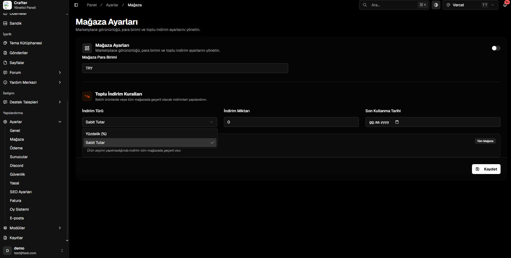

The Crafter Store Settings module allows you to control store visibility, define ISO currency codes, and launch scheduled sitewide flash sales without requiring coupon codes.

Navigate to [Dashboard \> Settings \> Store](https://app.crafter.net.tr/en/dashboard/settings/store) to update store rules.

<Frame caption="Store Settings & Bulk Discounts Panel">
  
</Frame>

---

## 1. Store Visibility & Currency

- **Store Status (Toggle):** Enable or temporarily disable the public web store.
- **Store Currency:** Standard ISO 4217 currency code (e.g., `USD`, `EUR`, `TRY`, `GBP`).

---

## 2. Bulk Store Discounts (Sales)

Apply automatic price reductions across all products or select categories:

<Steps>
  <Step title="Select Discount Model">
    - **Percentage (%):** Lowers item prices by a percentage (e.g., `20%`).
    - **Fixed Amount:** Subtracts a static value from each product price.
  </Step>
  <Step title="Enter Discount Value">
    Input the discount numeric amount (e.g., `20` or `50`).
  </Step>
  <Step title="Set Expiration Date">
    Select an end date from the calendar when the promotion will automatically deactivate.
  </Step>
  <Step title="Save and Launch">
    Click **Save** to update all catalog pricing immediately.
  </Step>
</Steps>
