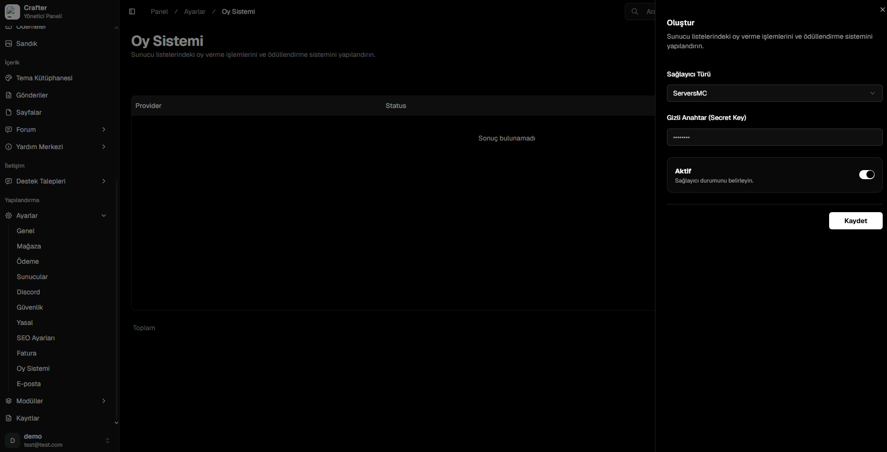

The Crafter CMS Vote System connects your gaming network with top server listing directories like [ServersMC](https://www.servers-mc.net) to award credits, crate keys, and ranking points to players who vote for your server.

Navigate to [Dashboard \> Settings \> Vote](https://app.crafter.net.tr/tr/dashboard/settings/vote) to manage vote providers.

<Frame caption="Vote Provider Configuration Interface">
  
</Frame>

---

## ServersMC Integration Setup

<Steps>
  <Step title="Navigate to ServersMC Profile">
    Log in to [ServersMC](https://www.servers-mc.net/me) and open the **Management / Settings** area for your registered server.
  </Step>
  <Step title="Copy Secret Key">
    Copy the alphanumeric **Secret Key** associated with your server.
  </Step>
  <Step title="Configure in Crafter CMS">
    Select `ServersMC` as the provider, paste your **Secret Key**, and set status to active.
  </Step>
  <Step title="Save">
    Click **Save** to enable real-time vote synchronization.
  </Step>
</Steps>
