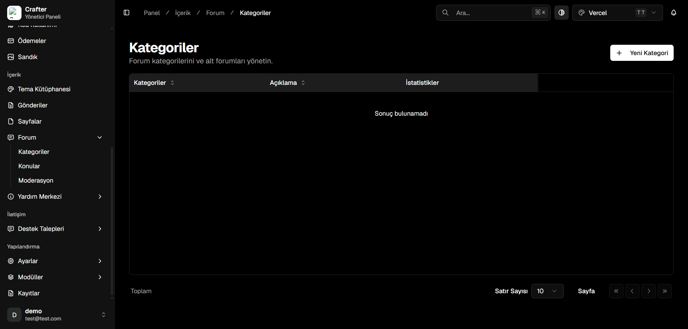
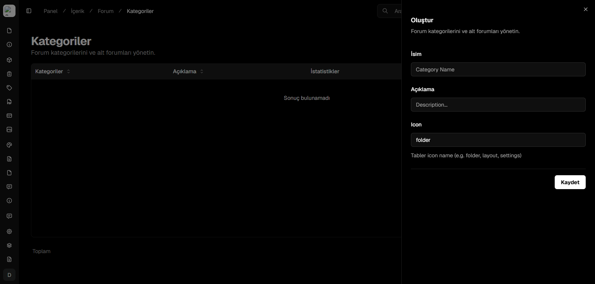

The Crafter Forum Categories module enables you to organize your community board into structured parent categories and subforums.

Navigate to [Dashboard \> Content \> Forum \> Categories](https://app.crafter.net.tr/tr/dashboard/content/forum/categories) to manage forum sections.

<Frame caption="Forum Categories Management Interface">
  
</Frame>

---

## Forum Categories Table

- **Categories:** Forum section title and accompanying icon.
- **Description:** Purpose, guidelines, and context of the forum board.
- **Statistics:** Real-time count of total discussion threads and replies.

---

## Creating a Forum Category

<Steps>
  <Step title="Open Category Creator">
    Click **+ New Category** in the top right corner.
  </Step>
  <Step title="Define Category Metadata">
    - **Name:** Title displayed on the forum (e.g., _General Discussion_, _Guides & Tutorials_).
    - **Description:** Summary explaining what discussions belong here.
    - **Icon:** FontAwesome or Lucide icon name (e.g., `folder`, `comments`, `book-open`).
  </Step>
  <Step title="Save Category">
    Click **Save** to make the forum board active.
  </Step>
</Steps>

<Frame caption="New Forum Category Creator Drawer">
  
</Frame>
