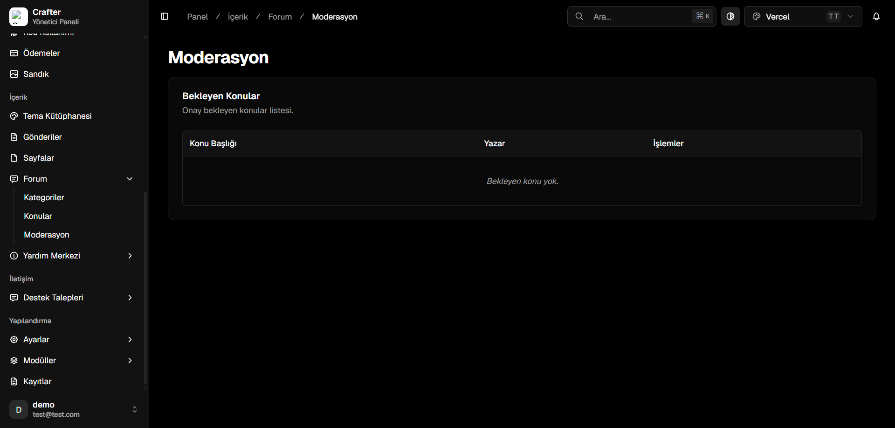

The Crafter Forum Moderation module allows your staff team to pre-screen player submissions before they are published publicly on your community boards.

Navigate to [Dashboard \> Content \> Forum \> Moderation](https://app.crafter.net.tr/en/dashboard/content/forum/moderation) to view the moderation queue.

<Frame caption="Forum Moderation Queue Interface">
  
</Frame>

---

## Moderation Queue Elements

- **Topic Title & Content:** Submission preview and target forum category.
- **Author:** Submitting user account.
- **Actions:** **Approve** (instantly publish) or **Reject** (discard submission).
