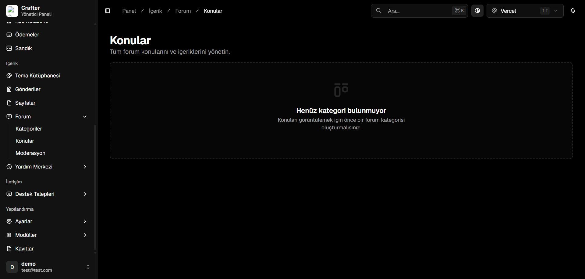

The Crafter Forum Topics module allows you to oversee all community conversations, lock controversial debates, pin critical announcements, and reorganize threads.

Navigate to [Dashboard \> Content \> Forum \> Topics](https://app.crafter.net.tr/en/dashboard/content/forum/topics) to moderate forum threads.

<Frame caption="Forum Topics Management Interface">
  
</Frame>

---

<Warning>
  **Prerequisite:** You must have at least one **Forum Category** created before topics can be listed and published. Configure categories on the [Forum Categories](/en/web-features/content/forum/categories) page.
</Warning>

---

## Moderation Actions

- **Review & Edit:** Correct typos, format markdown, or remove rule-breaking text.
- **Lock Topic:** Prevent further player replies on resolved or contested discussions.
- **Pin Topic:** Affix critical guides, server rules, or major announcements to the top of a category.
- **Move Category:** Transfer miscategorized threads into appropriate forum sections.
- **Delete Topic:** Permanently purge spam or toxic posts.
