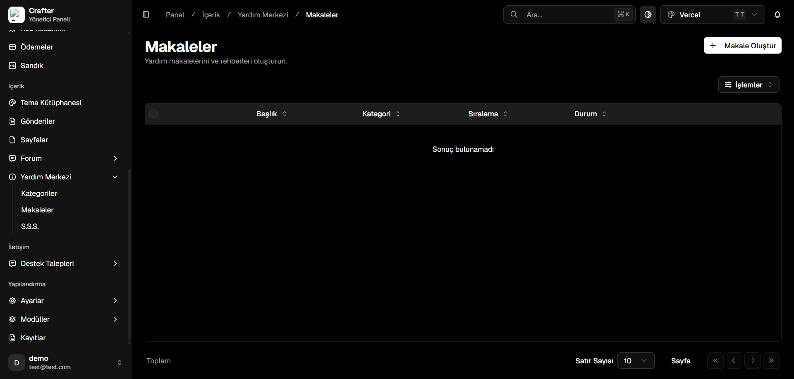
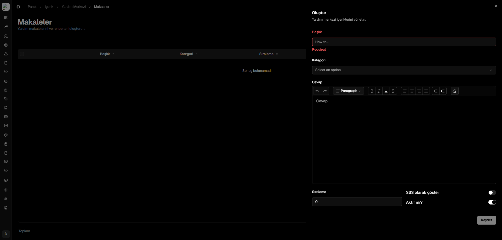

The Crafter Knowledge Base Articles module enables you to provide detailed walkthroughs, account recovery guides, and technical tutorials to reduce support ticket volumes.

Navigate to [Dashboard \> Content \> Help Center \> Articles](https://app.crafter.net.tr/en/dashboard/content/help-center/articles) to manage articles.

<Frame caption="Help Center Articles Overview">
  
</Frame>

---

## Article Attributes & Management

- **Title:** Headline and question prompt.
- **Category:** Assigned parent knowledge base category.
- **Sort Order:** Numerical display rank within the category.
- **Status:** Published or Draft.

---

## Creating an Article

<Steps>
  <Step title="Open Article Creator">
    Click **+ Create Article** in the top right corner.
  </Step>
  <Step title="Configure Content & Settings">
    - **Title:** Headline (e.g., _How to Secure Your Account with 2FA_).
    - **Category:** Select from the category dropdown.
    - **Answer:** Rich text formatted walkthrough with code blocks, links, and step-by-step instructions.
    - **Show in FAQ:** Toggle to feature this article on the quick FAQ section.
    - **Active:** Publish status.
  </Step>
  <Step title="Save Article">
    Click **Save** to publish.
  </Step>
</Steps>

<Frame caption="Article Creator Drawer">
  
</Frame>
