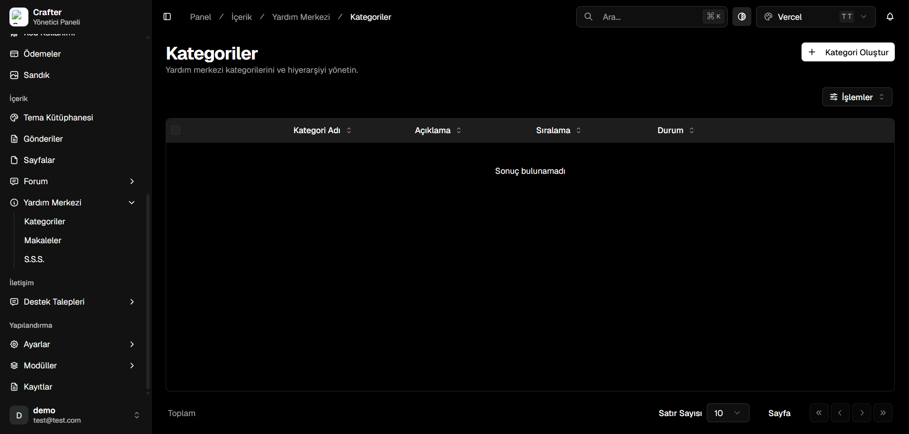
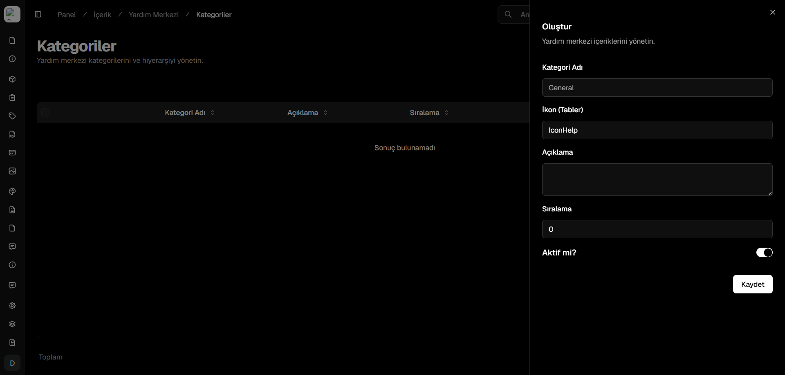

The Crafter Help Center Categories module lets you arrange support documentation, knowledge base articles, and onboarding tutorials into structured categories.

Navigate to [Dashboard \> Content \> Help Center \> Categories](https://app.crafter.net.tr/en/dashboard/content/help-center/categories) to manage help categories.

<Frame caption="Help Center Categories Management Interface">
  
</Frame>

---

## Help Categories Table

- **Category Name:** Section title shown in the knowledge base.
- **Description:** Summary of topics covered in this category.
- **Sort Order:** Numerical priority index determining page position.
- **Status:** Active (published) or Draft (hidden).

---

## Creating a Category

<Steps>
  <Step title="Open Category Creator">
    Click **+ Create Category** in the top right corner.
  </Step>
  <Step title="Configure Metadata">
    - **Category Name:** Title (e.g., _Account & Security_, _Store & Billing_).
    - **Icon (Tabler):** Tabler icon identifier (e.g., `IconHelp`, `IconShield`, `IconCreditCard`).
    - **Description:** Brief overview of the category scope.
    - **Sort Order:** Display order (e.g., `0`, `1`, `2`).
    - **Active:** Publish toggle.
  </Step>
  <Step title="Save">
    Click **Save** to publish the category.
  </Step>
</Steps>

<Frame caption="Help Center Category Creator Drawer">
  
</Frame>
