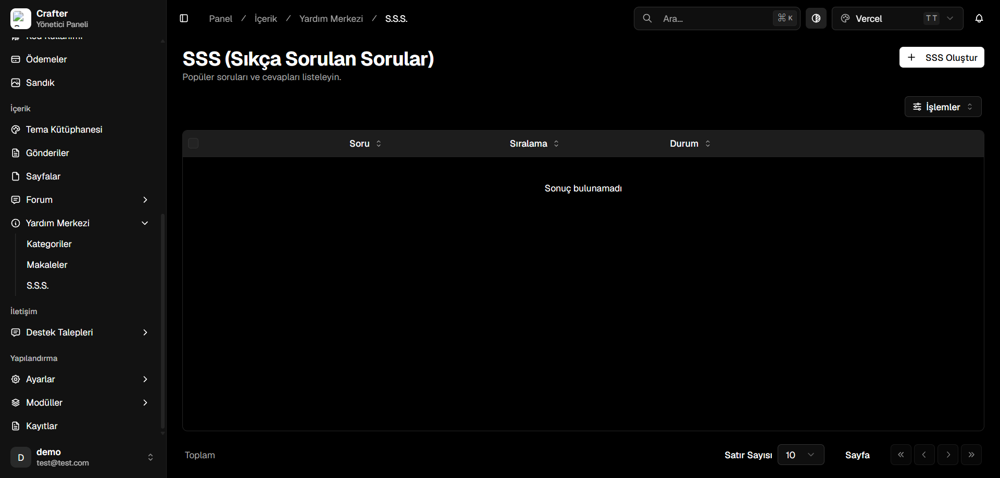
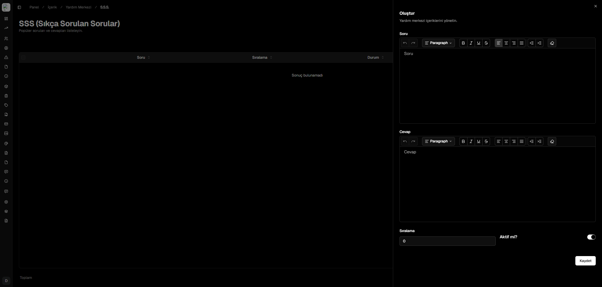

The Crafter FAQ module enables you to address common player questions about store deliveries, rules, ranks, and server connection issues.

Navigate to [Dashboard \> Content \> Help Center \> FAQ](https://app.crafter.net.tr/tr/dashboard/content/help-center/faqs) to manage questions.

<Frame caption="FAQ Management Interface">
  
</Frame>

---

## Creating an FAQ Entry

<Steps>
  <Step title="Open FAQ Creator">
    Click **+ Create FAQ** in the top right corner.
  </Step>
  <Step title="Enter Question & Answer">
    - **Question:** Short, clear inquiry prompt (e.g., _When will my VIP rank activate after payment?_).
    - **Answer:** Detailed solution text with formatting.
    - **Sort Order:** Numerical position index.
    - **Active:** Publish toggle.
  </Step>
  <Step title="Save">
    Click **Save** to publish the entry.
  </Step>
</Steps>

<Frame caption="FAQ Creator Drawer">
  
</Frame>
