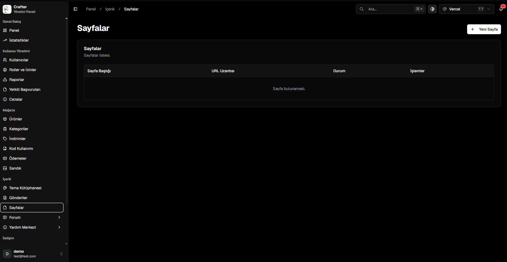
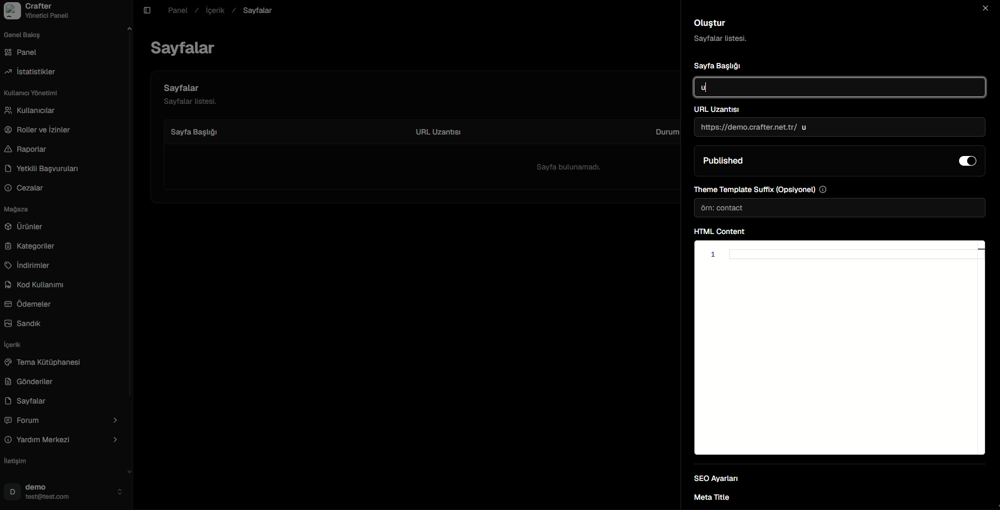

The Crafter Custom Pages module allows you to build informative static pages such as Server Rules, About Us, Terms of Service, or Lore Guides.

Navigate to [Dashboard \> Content \> Pages](https://app.crafter.net.tr/en/dashboard/content/pages) to manage existing pages or build new ones.

<Frame caption="Pages Management Overview">
  
</Frame>

---

## Creating a Custom Page

<Steps>
  <Step title="Open Page Creator">
    Click **+ New Page** in the top right corner of the Pages screen.
  </Step>
  <Step title="Configure Title & URL Path">
    - **Page Title:** Display name (e.g., _Server Rules_, _Staff Team_).
    - **Slug:** URL path (e.g., `yourdomain.com/rules`).
    - **Published:** Visibility toggle.
  </Step>
  <Step title="Theme Template Suffix (Optional)">
    Assign a custom layout template suffix to override the standard page container.
  </Step>
  <Step title="Enter HTML / Body Content">
    Insert custom HTML, CSS styling, or markdown into the editor.
  </Step>
  <Step title="Set SEO & Save">
    Configure Meta Title and Meta Description, then click **Create**.
  </Step>
</Steps>

<Frame caption="Page Creation & Template Assignment Panel">
  
</Frame>

---

## Understanding Theme Template Suffixes

By default, pages render using your active theme's `templates/page.liquid` template. To render a custom bespoke design for specific pages, use **Theme Template Suffixes**:

<Info>
  - If left **empty**, Crafter compiles `templates/page.liquid`.
  - If you enter `contact`, the system compiles `templates/page.contact.liquid`.
  - If you enter `rules`, the system compiles `templates/page.rules.liquid`.
</Info>
