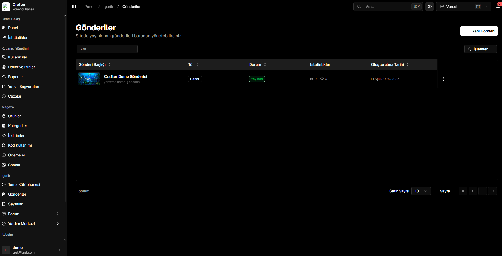
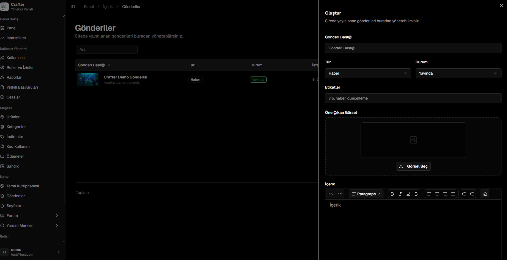

The Crafter Posts module provides a full-featured blogging and announcement system for sharing game updates, patch notes, and community announcements.

Navigate to [Dashboard \> Content \> Posts](https://app.crafter.net.tr/en/dashboard/content/posts) to manage articles or write new announcements.

<Frame caption="Posts Management Dashboard">
  
</Frame>

---

## Publishing a Post

<Steps>
  <Step title="Open Article Editor">
    Click **+ New Post** in the top right corner.
  </Step>
  <Step title="Configure Title & Classification">
    - **Title:** Headline displayed on the website. Generates an SEO-friendly slug automatically (e.g., `/summer-update-notes`).
    - **Type:** Category tag (_News_, _Announcement_, _Changelog_).
    - **Status:** State (_Published_, _Draft_).
    - **Tags:** Comma-separated tags (e.g., `update, survival, event`).
  </Step>
  <Step title="Select Featured Image">
    Upload a cover banner or select one from the Media Library.
  </Step>
  <Step title="Compose Content">
    Use the rich text editor to compose articles with headers, lists, code blocks, and embedded links.
  </Step>
  <Step title="Configure SEO & Social Settings">
    - **Pinned:** Pin the announcement to the top of the homepage.
    - **Trending:** Highlight among featured stories.
    - **Meta Description & OG Image:** Optimize social sharing previews for Discord and Twitter/X.
  </Step>
  <Step title="Save and Publish">
    Click **Save** to make the post public.
  </Step>
</Steps>

<Frame caption="Article Composition & SEO Drawer">
  
</Frame>
