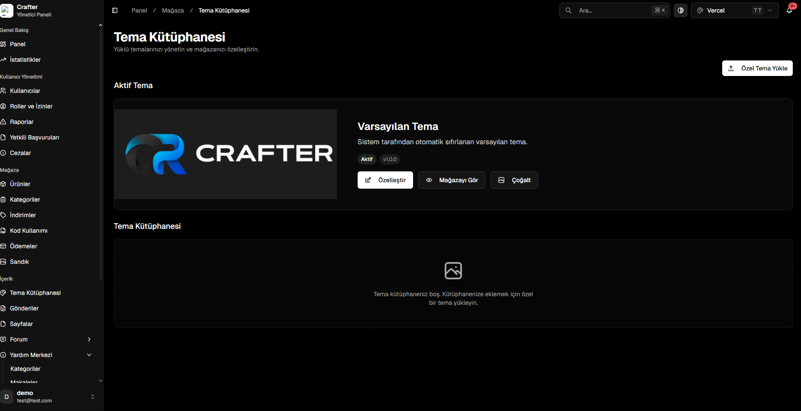
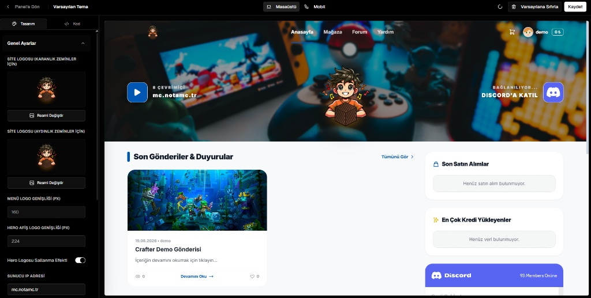
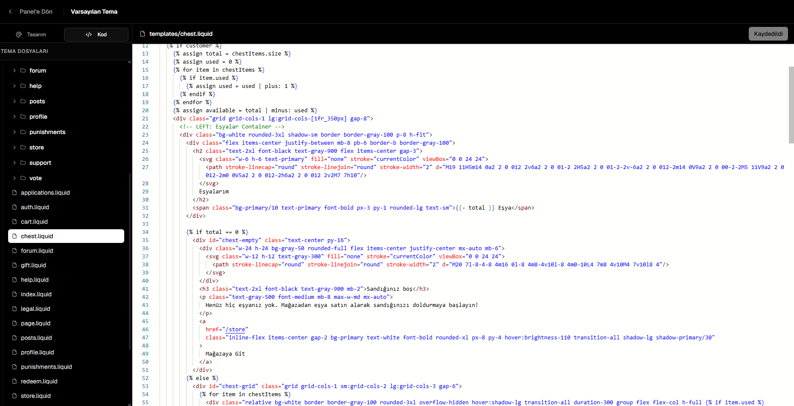

The Crafter CMS Theme Library allows you to transform your website design in seconds, personalize styling with our live visual visualizer, and modify theme source code using the Liquid template engine.

Navigate to [Dashboard \> Content \> Themes](https://app.crafter.net.tr/tr/dashboard/store/themes) to manage installed themes or acquire new designs.

<Frame caption="Theme Library Overview">
  
</Frame>

---

## Installing Themes

<Tabs>
  <Tab title="From the Marketplace (Recommended)">
    Instantly deploy modern responsive themes from the official store.

    <Steps>
      <Step title="Visit Marketplace">
        Go to [Crafter Marketplace](https://crafter.net.tr/marketplace).
      </Step>
      <Step title="Select & Deploy Theme">
        Choose your desired theme and click **Add to My Website**. The theme installs directly into your library.
      </Step>
    </Steps>
  </Tab>
  <Tab title="Upload Custom Theme (ZIP)">
    Upload external or privately developed custom themes.

    <Steps>
      <Step title="Open Upload Dialog">
        Click **Upload Custom Theme** in the top right corner.
      </Step>
      <Step title="Select Archive">
        Select your `.zip` theme archive to complete the upload.
      </Step>
    </Steps>
  </Tab>
</Tabs>

---

## Theme Studio & Customization

Click **Customize** on your active theme to access the dual-mode Theme Studio:

<Tabs>
  <Tab title="Visual Design Studio">
    Modify colors, typography, logos, and layout elements with real-time live preview.

    <Frame caption="Live Visual Customizer">
      
    </Frame>

    - **Dynamic Controls:** Options adapt to the theme's `settings_schema` (branding colors, logo sizes, banners, typography).
    - **Live Sandbox Preview:** Test modifications before saving.
    - **Device Simulation:** Toggle between **Desktop** and **Mobile** viewports.
  </Tab>
  <Tab title="Liquid Code Editor">
    Full-featured browser IDE for frontend developers.

    <Frame caption="Liquid Code Editor & File Tree">
      
    </Frame>

    - **File Tree:** Access all templates including `store.liquid`, `chest.liquid`, `forum/`, and `punishments.liquid`.
    - **Liquid Syntax Support:** Dynamic variables, loops (``), logic conditionals (``), and filters.
    - **Revision History:** Revert to default templates with a single click.
  </Tab>
</Tabs>
