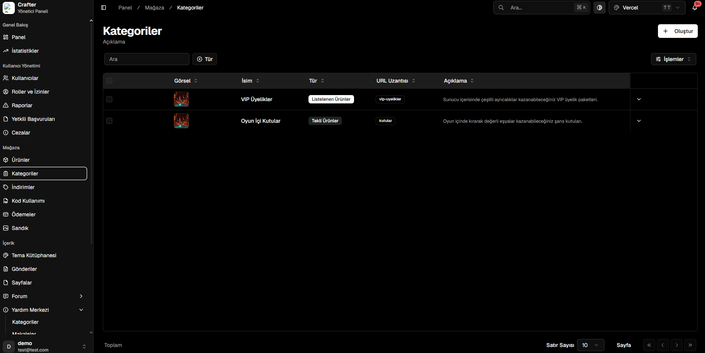
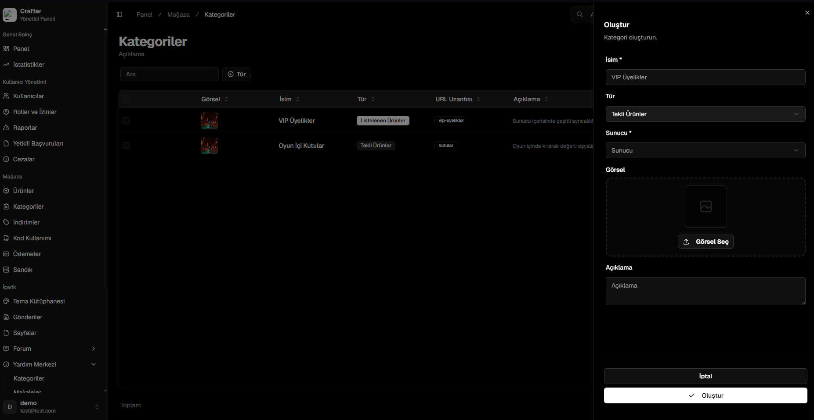

Crafter Store Categories allow you to organize your web store into logical departments such as VIP memberships, crate keys, currencies, or server-specific bundles.

Navigate to [Dashboard \> Store \> Categories](https://app.crafter.net.tr/en/dashboard/store/categories) to manage existing categories or add new ones.

<Frame caption="Store Categories Management List">
  
</Frame>

---

## Creating a Category

<Steps>
  <Step title="Open Category Creator">
    Click the **+ Create** button in the top right corner of the Categories page.
  </Step>
  <Step title="Configure Details & Display Type">
    - **Name:** Title displayed in the store navigation (e.g., `VIP Ranks`, `In-Game Crates`).
    - **Type:**
      - **Listed Products:** Traditional catalog grid displaying multiple products.
      - **Single Product Showcase:** Featured showcase highlight focusing on dedicated packages.
    - **Server:** Target server where items in this category apply.
  </Step>
  <Step title="Select Category Image">
    Choose a banner/icon from the Crafter Media Library or upload a custom image.
  </Step>
  <Step title="Enter Description & Save">
    Add a brief summary describing what perks players receive, then click **Create**.
  </Step>
</Steps>

<Frame caption="Category Creation & Edit Panel">
  
</Frame>

---

## URL Slugs & Clean Routing

Each category receives a clean, SEO-optimized URL path:

- **VIP Memberships:** `yourdomain.com/store/<server>/vip-ranks`
- **Crates:** `yourdomain.com/store/<server>/crates`

<Tip>
  After creating categories, visit the [Products](https://app.crafter.net.tr/en/dashboard/store/products) page to assign items to your newly created categories.
</Tip>
