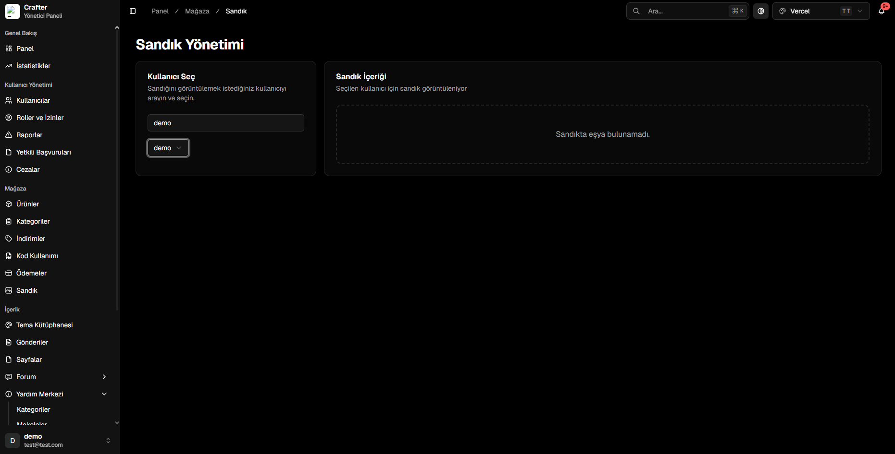

The Crafter Web Chest system serves as a virtual player inventory holding purchased items, wheel spin rewards, and staff-granted gifts before players transfer them into an active game server.

Navigate to [Dashboard \> Store \> Chest](https://app.crafter.net.tr/tr/dashboard/store/chest) to manage individual player chest inventories.

<Frame caption="Web Chests Management Interface">
  
</Frame>

---

## Inspecting a Player's Web Chest

<Steps>
  <Step title="Search for Player">
    Type the target player's username into the **Select User** search box on the left.
  </Step>
  <Step title="Select Account">
    Choose the account from results to load their active chest items in the right-hand panel.
  </Step>
</Steps>

---

## Administrative Actions

From the chest panel, administrators can:

- **Add Item:** Manually grant a store package, crate key, or special voucher into the player's chest.
- **Revoke Item:** Remove refunded or erroneously granted items.
- **Trigger In-Game Delivery:** Instantly dispatch console delivery commands to an active server on behalf of the player.

<Note>
  Players can log in to your website and access `yourdomain.com/chest` to claim their items into their current server at any time with a single click.
</Note>
