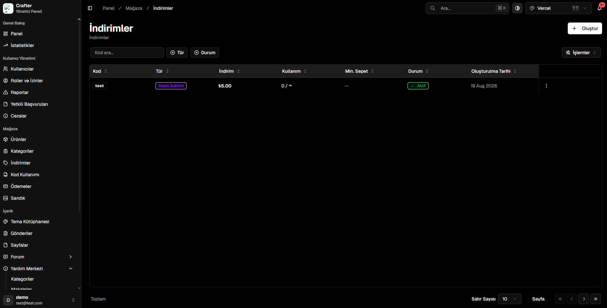
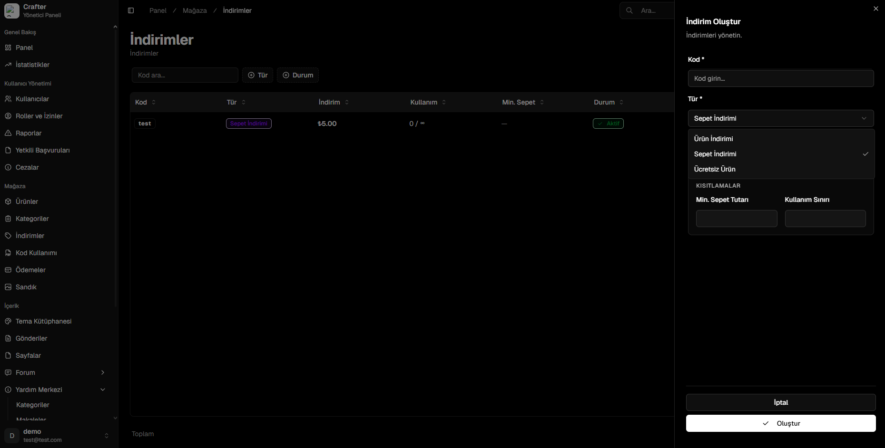

The Crafter CMS Discounts module enables you to run promotional campaigns, seasonal sales, and coupon giveaways to boost player engagement and store revenue.

Navigate to [Dashboard \> Store \> Discounts](https://app.crafter.net.tr/tr/dashboard/store/discounts) to manage active coupons or create new promotional codes.

<Frame caption="Discounts & Coupon Management Overview">
  
</Frame>

---

## Creating a Discount Coupon

<Steps>
  <Step title="Open Coupon Creator">
    Click the **+ Create** button in the top right corner of the Discounts page.
  </Step>
  <Step title="Set the Coupon Code">
    - **Code:** Alphanumeric promo key entered by players at checkout (e.g., `SUMMER2026`, `VIP15`, `WELCOME`).
  </Step>
  <Step title="Choose Discount Type">
    - **Cart Discount:** Applies a fixed amount or percentage discount to the entire basket total.
    - **Product Discount:** Targets specific items or categories.
    - **Free Product:** Automatically adds a designated promotional product at zero cost.
  </Step>
  <Step title="Configure Quotas & Minimum Spend">
    - **Min. Cart Total:** Minimum basket spend required to activate the code.
    - **Usage Limit:** Maximum number of redemptions allowed across the server (leave empty for unlimited `∞`).
  </Step>
  <Step title="Publish Coupon">
    Click **Create** to launch the promotion immediately.
  </Step>
</Steps>

<Frame caption="Discount Coupon Creation Panel">
  
</Frame>

---

## Coupon Tracking & Analytics

Every coupon is displayed with real-time redemption metrics:

- **Code:** Promo identifier.
- **Type:** Category (Cart Discount, Product Discount, Free Item).
- **Discount:** Value (e.g., `₺5.00` or `15%`).
- **Usage:** Current vs max redemptions (e.g., `12 / 50` or `0 / ∞`).
- **Min. Cart:** Threshold spend.
- **Status:** Active, Disabled, or Expired.
- **Created Date:** Creation timestamp.
