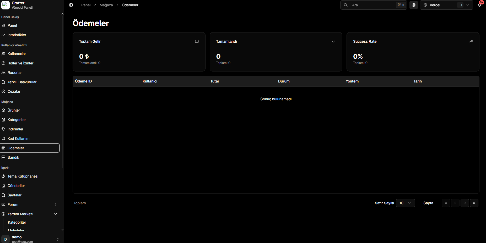

The Crafter Payments module records all balance top-ups, measures gateway checkout conversion rates, and consolidates server revenue in a single analytical dashboard.

Navigate to [Dashboard \> Store \> Payments](https://app.crafter.net.tr/en/dashboard/store/payments) to inspect financial records.

<Frame caption="Payments & Financial Analytics Dashboard">
  
</Frame>

---

## Key Financial Indicators (KPIs)

- **Total Revenue:** Gross earnings from completed transactions.
- **Completed Orders:** Total volume of successfully processed checkouts.
- **Success Rate:** Percentage ratio of successful payments versus attempted checkouts.

---

## Transaction Log Table

Every checkout attempt is logged with technical parameters:

- **Payment ID:** Unique transaction identifier.
- **User:** Account username.
- **Amount:** Currency volume paid.
- **Status:** State (_Completed_, _Pending_, _Failed_).
- **Method / Provider:** Payment gateway (Credit Card, Shopier, PayTR, Stripe, etc.).
- **Timestamp:** Precise completion date and time.
