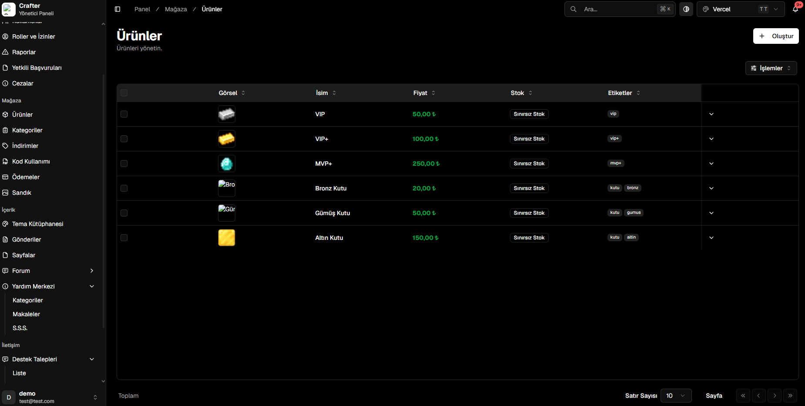
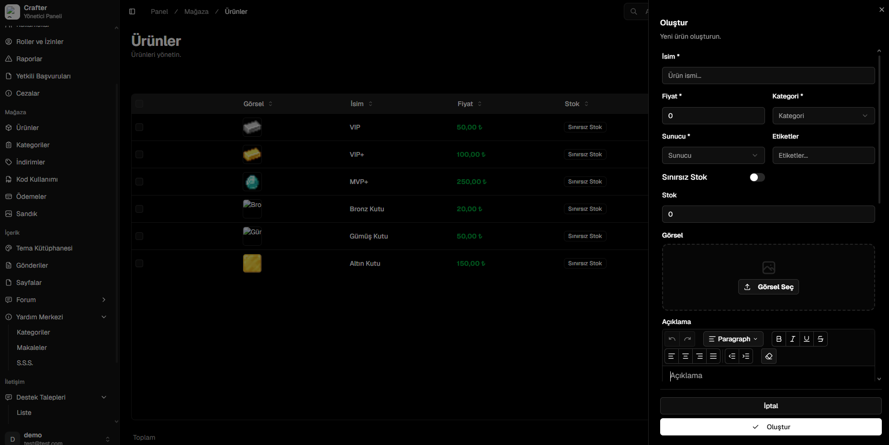

The Crafter Store system enables you to sell VIP ranks, in-game currency, loot crates, and cosmetics with zero-latency automated command delivery to your game servers.

Navigate to [Dashboard \> Store \> Products](https://app.crafter.net.tr/en/dashboard/store/products) to list, edit, or create new store items.

<Frame caption="Store Products Management List">
  
</Frame>

---

## Creating a New Product

Follow these steps to publish a new product with automated in-game fulfillment:

<Steps>
  <Step title="Open Product Creator">
    Click the **+ Create** button in the top right corner of the Products page.
  </Step>
  <Step title="Configure Core Details & Price">
    - **Name:** Product title displayed on the web store (e.g., `VIP+`, `Diamond Key Bundle`).
    - **Price:** Sale price in Credits or real currency.
    - **Category:** Store category (e.g., Memberships, Crates).
    - **Server:** Target game server where execution commands should be sent.
    - **Tags:** Filter tags (e.g., `vip`, `bundle`).
    - **Stock:** Enable unlimited stock or set a fixed quantity limit.
  </Step>
  <Step title="Select Product Image">
    Choose from the built-in Crafter Media Library or upload a custom image.
  </Step>
  <Step title="Provide Description & Perks">
    Use the rich text editor to highlight product benefits and terms of use.
  </Step>
  <Step title="Define Fulfillment Commands">
    Enter the console commands that should automatically execute upon purchase.

    <Warning>
      **Command Syntax:** Do **not** prefix commands with a slash (`/`). Commands execute directly through the server console (e.g., `lp user %username% parent add vip`).
    </Warning>
  </Step>
</Steps>

<Frame caption="Product Creation & Configuration Drawer">
  
</Frame>

---

## Supported Command Placeholders

Use dynamic placeholders to insert the purchaser's data into delivery commands:

| Placeholder | Description | Example Usage |
| :-- | :-- | :-- |
| `%username%` | Purchaser's username | `lp user %username% parent add vip` |
| `%uuid%` | Purchaser's unique Minecraft UUID | `crate give key %uuid% gold 1` |
| `%ip%` | Purchaser's client IP address | `security log %username% %ip%` |

---

## Example Fulfillment Scenarios

<Tabs>
  <Tab title="Rank & VIP Delivery (LuckPerms)">
    ```text
    lp user %username% parent addtemp vip 30d
    broadcast &a%username% &fjust purchased &630-Day VIP &ffrom the web store!
    ```
  </Tab>
  <Tab title="Crate Keys & Currency">
    ```text
    crate givekey %username% epic 3
    eco give %username% 50000
    ```
  </Tab>
</Tabs>
