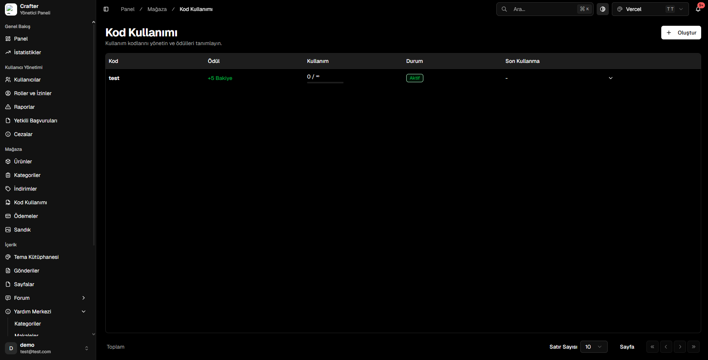
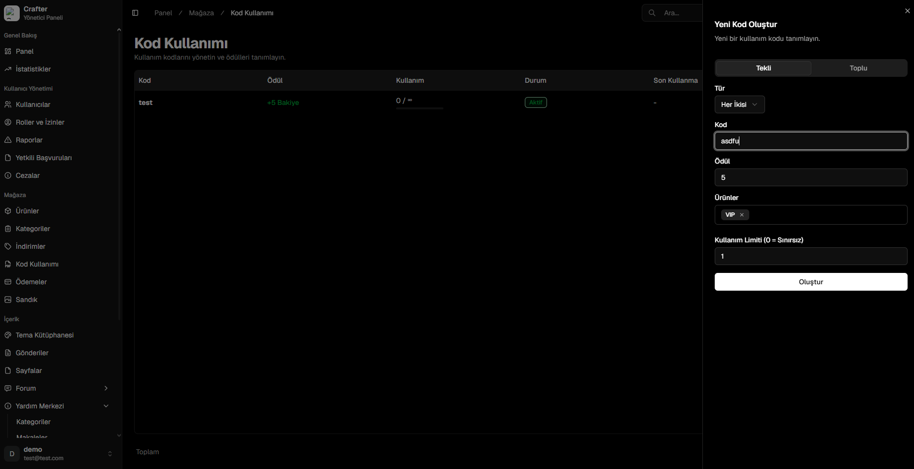
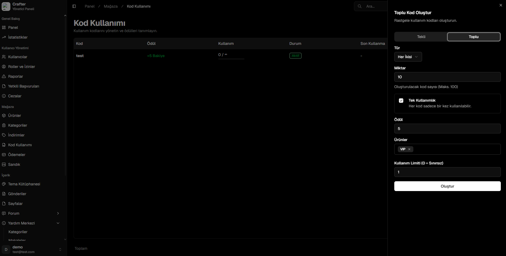

The Crafter Redeem Codes module enables you to generate promotional voucher keys for Discord giveaways, social media drops, or player compensation.

Navigate to [Dashboard \> Store \> Redeem Codes](https://app.crafter.net.tr/en/dashboard/store/redeem-codes) to list active codes and generate new keys.

<Frame caption="Redeem Codes Management List">
  
</Frame>

---

## Code Generation Modes

<Tabs>
  <Tab title="Single Code Generator">
    Used for custom promotional vanity words or singular high-value keys.

    <Steps>
      <Step title="Open Creator Drawer">
        Click **+ Create** and select the **Single** tab.
      </Step>
      <Step title="Configure Reward & Code Name">
        - **Type:** Reward category (_Balance_, _Product_, or _Both_).
        - **Code:** Keyword entered by players (e.g., `WELCOME2026`).
        - **Reward:** Credit amount (e.g., `5`).
        - **Products:** Store products deposited directly into the player's web chest (e.g., `VIP`).
      </Step>
      <Step title="Set Usage Limit">
        - **Usage Limit:** Max total redemptions across unique users (`0` for unlimited).
      </Step>
      <Step title="Save and Activate">
        Click **Create** to activate the key immediately.
      </Step>
    </Steps>

    <Frame caption="Single Code Creation Panel">
      
    </Frame>
  </Tab>
  <Tab title="Bulk Code Generator">
    Instantly generate batches of randomized keys for giveaways and creator partnerships.

    <Steps>
      <Step title="Switch to Bulk Tab">
        Click **+ Create** and select the **Bulk** option.
      </Step>
      <Step title="Set Batch Quantity & Rules">
        - **Quantity:** Total random keys to generate (up to 100 per batch).
        - **Single Use:** Check to make each individual key single-use before auto-expiring.
      </Step>
      <Step title="Configure Global Rewards">
        Assign the reward type (_Credits_, _Items_) for all keys in the batch.
      </Step>
      <Step title="Generate Batch">
        Click **Create** to export the keys.
      </Step>
    </Steps>

    <Frame caption="Bulk Code Creation Panel">
      
    </Frame>
  </Tab>
</Tabs>

---

## Redemption & Player Claiming

Players redeem keys on your website at `yourdomain.com/profile/redeem`. Rewards are credited instantly to their account balance or web chest.
