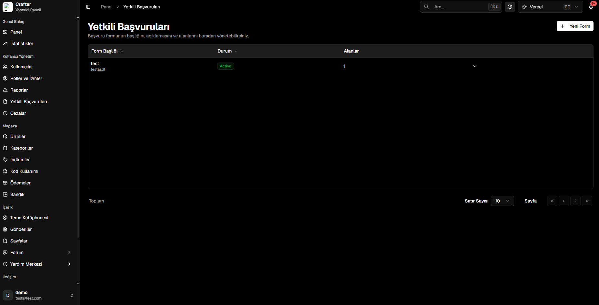
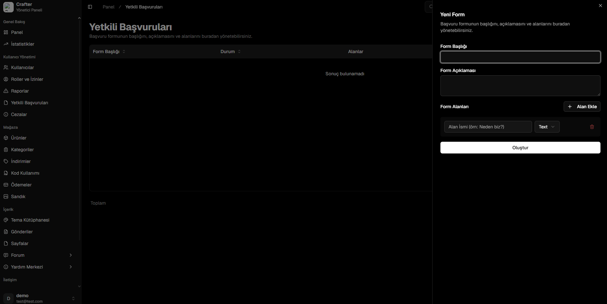
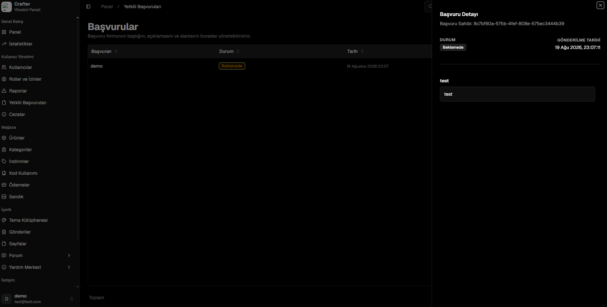

The Crafter Staff Applications module enables you to recruit Helpers, Builders, Moderators, or Developers through custom interactive questionnaires on your website.

- **Dashboard:** [Dashboard \> Staff Applications](https://app.crafter.net.tr/tr/dashboard/applications)
- **Public Application URL:** `yourdomain.com/applications/form`

<Frame caption="Staff Applications Overview & Form Management">
  
</Frame>

---

## Creating a Dynamic Application Form

Design custom questionnaires tailored to specific staff positions:

<Steps>
  <Step title="Open Form Builder">
    Navigate to [Dashboard \> Staff Applications](https://app.crafter.net.tr/tr/dashboard/applications) and click **New Form** in the top-right corner.
  </Step>
  <Step title="Configure General Information">
    - **Form Title:** Display name on the website (e.g., Helper Recruitment, Moderator Application).
    - **Description:** Requirements, age guidelines, or rules for applicants.
  </Step>
  <Step title="Add Dynamic Fields">
    Click **+ Add Field** to insert questions. Choose custom labels, placeholders, and data types.
  </Step>
  <Step title="Publish Form">
    Click **Create** to make the form publicly available on your website.
  </Step>
</Steps>

<Frame caption="Form Field Builder">
  
</Frame>

---

## Supported Field Types

- **Text:** Short or multi-line paragraph answers (e.g., "Why do you want to join our team?").
- **Number:** Numeric input (e.g., Age, daily active hours).
- **Email:** Validated email format.
- **Phone:** Phone number input.
- **Date/Time:** Date picker for birthdays or availability.
- **Checkbox:** Confirmation toggles (e.g., "I have read and agree to staff rules").
- **Select:** Dropdown menu for single-choice answers (e.g., Preferred Realm / Gamemode).

---

## Reviewing Submissions

When applicants submit forms at `yourdomain.com/applications/form`, entries are instantly available in your dashboard.

<Steps>
  <Step title="Filter Applications">
    Filter incoming applications by form title or candidate status.
  </Step>
  <Step title="Evaluate Candidate Answers">
    Open the candidate dossier to inspect submitted answers and account history.
  </Step>
  <Step title="Update Status">
    Mark the application as **Approved**, **Rejected**, or **Under Review**.
  </Step>
</Steps>

<Frame caption="Candidate Review Screen">
  
</Frame>
