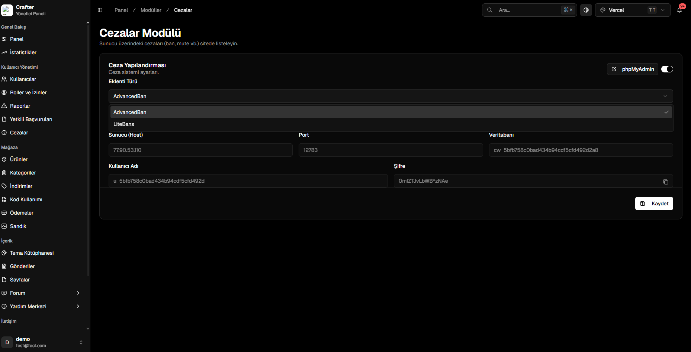
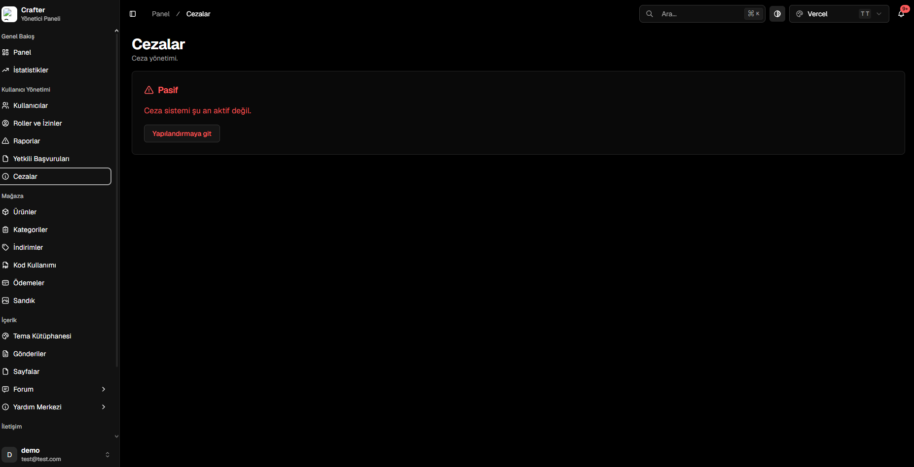

The Crafter CMS Punishments module integrates directly with industry-standard server plugins (`AdvancedBan`, `LiteBans`) via MySQL database bridge to display public ban lists and centralized moderation history.

- **Dashboard Punishments:** [Dashboard \> Punishments](https://app.crafter.net.tr/tr/dashboard/punishments)
- **Public Website Page:** `yourdomain.com/punishments`

---

## Setup & Configuration

Follow these steps to link your Minecraft server’s ban plugin with Crafter CMS:

<Steps>
  <Step title="Enable the Module">
    1. Navigate to [Dashboard \> Modules \> Punishments](https://app.crafter.net.tr/tr/dashboard/modules/punishments).
    2. Toggle on the module switch in the top right corner.
    3. Select your plugin from the **Plugin Type** dropdown (`AdvancedBan` or `LiteBans`).

    <Frame caption="Punishments Configuration Interface">
      
    </Frame>
  </Step>
  <Step title="Copy Database Credentials">
    Crafter allocates a dedicated MySQL cloud database for your server. Copy the generated credentials:
    - **Host IP**
    - **Port**
    - **Database Name** (`cw_...`)
    - **Username** (`u_...`)
    - **Password**
  </Step>
  <Step title="Update Plugin Configuration">
    Open your server's plugin configuration file (`config.yml`) and insert the database credentials:

    <Tabs>
      <Tab title="AdvancedBan">
        ```yaml config.yml
        MySQL:
          Custom: true
          IP: "HOST_IP_FROM_PANEL"
          Port: 12783 # Port from panel
          Database: "cw_your_database"
          User: "u_your_user"
          Password: "YourPassword"
        ```
      </Tab>
      <Tab title="LiteBans">
        ```yaml config.yml
        driver: "MySQL"
        address: "HOST_IP_FROM_PANEL:PORT"
        database: "cw_your_database"
        username: "u_your_user"
        password: "YourPassword"
        ```
      </Tab>
    </Tabs>
  </Step>
  <Step title="Save and Reload Plugin">
    Save the configuration and reload the plugin on your Minecraft server (`/litebans reload` or `/advancedban reload`).
  </Step>
</Steps>

---

## Database Management (phpMyAdmin)

You can manage tables, import historical records, or run custom SQL queries using our integrated phpMyAdmin instance:

<Card title="Crafter phpMyAdmin Access" icon="database" href="https://pma.crafter.net.tr">
  Visit `pma.crafter.net.tr` and sign in using the MySQL credentials provided in your Punishments module page.
</Card>

---

## Viewing Punishments

<Frame caption="Dashboard Punishments Management Screen">
  
</Frame>

- **Dashboard:** Filter active and expired penalties, review issuing staff members, reasons, and expiry times.
- **Public Web Page:** Players can visit `yourdomain.com/punishments` to inspect moderation transparency in real time.
