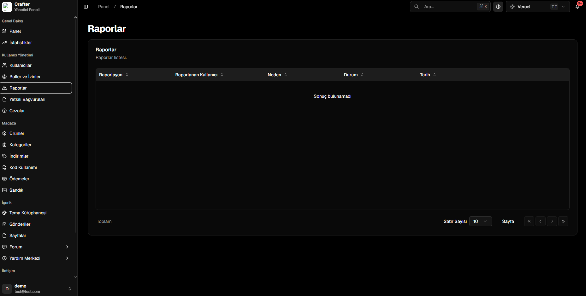

The Crafter CMS Reports module enables players to report rule violations, griefing, hacking, or inappropriate behavior directly via the website.

Staff members can investigate incoming reports from a unified interface, review submitted evidence, and apply necessary disciplinary actions.

Navigate to [Dashboard \> User Management \> Reports](https://app.crafter.net.tr/tr/dashboard/reports) to view all submitted player reports.

<Frame caption="Reports Management Overview">
  
</Frame>

---

## Report Data & Attributes

Every incoming report contains key investigative details:

- **Reported By:** The user account that filed the report.
- **Reported User:** Target player suspected of violating rules.
- **Reason:** Violation category and player-provided justification (e.g., Cheating, Chat Abuse).
- **Status:** Current operational state (Pending, Under Review, Approved, Rejected).
- **Date & Time:** Submission timestamp.

---

## Report Workflow

<Steps>
  <Step title="Player Files a Report">
    Players submit reports through user profiles, forum posts, or designated reporting pages on your website.
  </Step>
  <Step title="Staff Reviews Evidence">
    Staff members open the report in the dashboard, evaluate chat logs, screenshots, or video proof.
  </Step>
  <Step title="Action is Taken & Status Updated">
    If the violation is confirmed, staff issue a ban or warning via the [Punishments Module](https://app.crafter.net.tr/tr/dashboard/modules/punishments) and close the report.
  </Step>
</Steps>

<Tip>
  Ensure staff roles have the `manage_reports` permission enabled under [Roles & Permissions](https://app.crafter.net.tr/tr/dashboard/roles).
</Tip>
