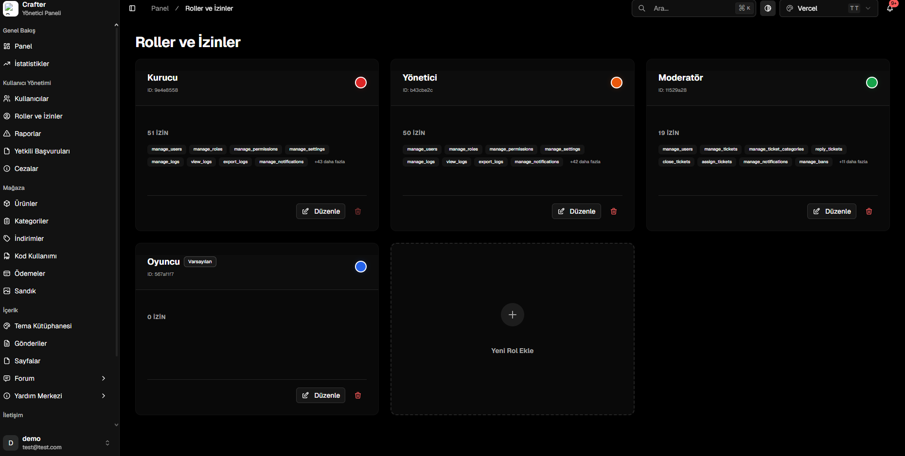
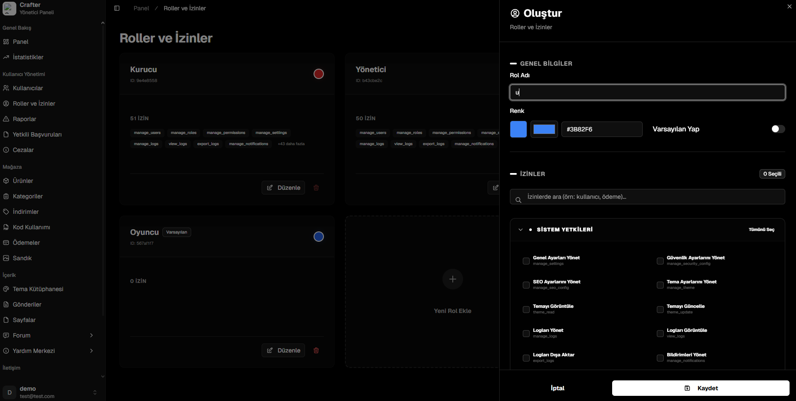
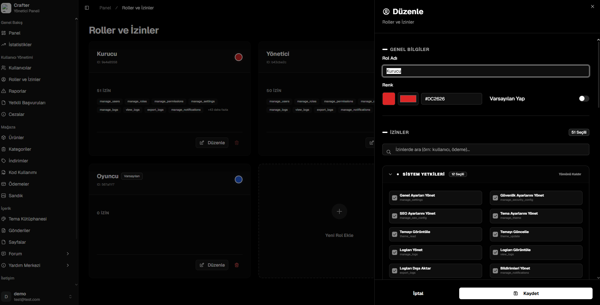

Crafter features a robust **Role-Based Access Control (RBAC)** architecture that allows you to configure exact staff and player permissions across the entire platform.

Navigate to [Dashboard \> User Management \> Roles & Permissions](https://app.crafter.net.tr/tr/dashboard/roles) to configure roles or create custom permission tiers.

<Frame caption="Roles & Permissions Management Screen">
  
</Frame>

---

## System Roles & Protections

To guarantee security and stability, essential core roles are pre-configured:

- **Owner:** Top-level superadmin role. Full access to all modules, settings, and logs. Cannot be deleted.
- **Admin:** High-level operational role for network managers. Cannot be deleted.
- **Moderator:** Handles tickets, player reports, and punishment operations.
- **Player (Default):** Automatically assigned to newly registered users. Grants standard player access without dashboard permissions. Cannot be deleted.

<Warning>
  **Protected Roles:** System roles such as `Owner`, `Admin`, and `Player` cannot be deleted to ensure system stability.
</Warning>

---

## Creating a Custom Role

Define specialized roles for your staff members (e.g., Helpers, Builders, Support Agents):

<Steps>
  <Step title="Open the Creation Drawer">
    Click **Add New Role** on the Roles & Permissions overview page.
  </Step>
  <Step title="Define General Attributes">
    Configure the core role properties:
    - **Role Name:** Display name (e.g., Support Team, Helper, Trial Mod).
    - **Color:** HEX color code for profile badges and dashboard highlights (e.g., `#3B82F6`).
    - **Make Default:** Enable if newly registered accounts should automatically receive this role.
  </Step>
  <Step title="Select Permissions and Save">
    Expand permission categories and toggle the exact capabilities you wish to assign, then click **Save**.
  </Step>
</Steps>

<Frame caption="New Role Creation Panel">
  
</Frame>

---

## Role Editing & Permission Matrix

Click **Edit** on any role card to customize permissions or modify badge colors.

<Frame caption="Role Permission Matrix Editor">
  
</Frame>

### Permission Categories

Permissions are organized by module:

- **System Permissions:** Settings (`manage_settings`), Security (`manage_security_config`), SEO, and Audit Logs (`view_logs`, `export_logs`).
- **User & Moderation:** User account modifications, punishments, and staff applications.
- **Store & Finance:** Product creation, categories, coupon codes, and transaction histories.
- **Content & Themes:** Blog posts, forum management, help center articles, and theme templates.

<Tip>
  Use the **Search Permissions** filter at the top of the matrix to quickly locate specific permission nodes (e.g., `payment`, `theme`, `ticket`).
</Tip>
