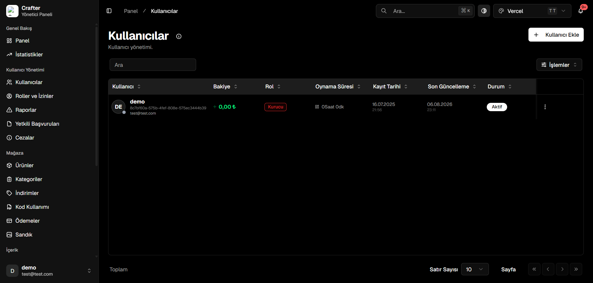
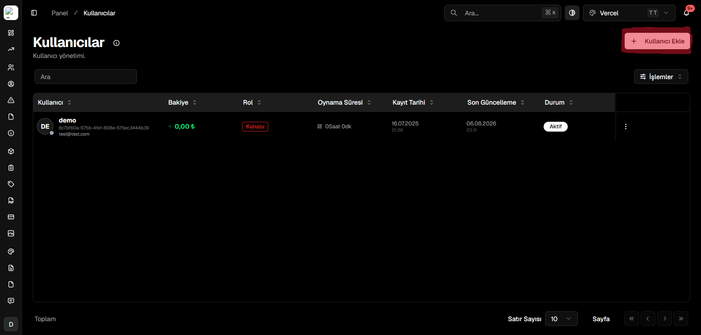
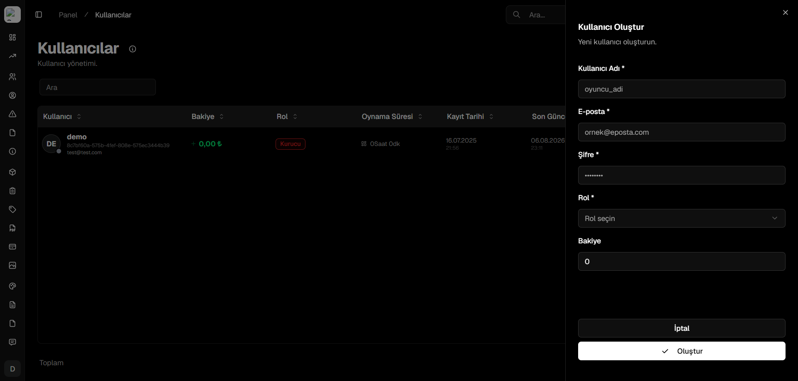
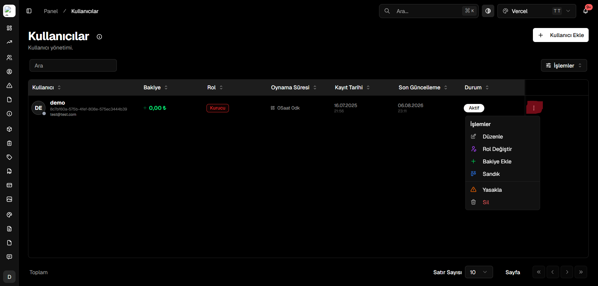

<Frame>
  
</Frame>

On this page, you can view and manage all registered players and accounts on your gaming platform.

---

## User Management Operations

### Adding Users Manually

To manually create a user account from the dashboard, click the designated button shown below:

<Frame>
  

  
</Frame>

Fill in the required user credentials (username, email, initial password, and role) to add the account.

### Editing & Managing Existing Users

Click the action menu icon next to any user row to view account management options:

<Frame>
  
</Frame>

From the actions dropdown, you can:
- Edit profile details and email addresses
- Change user role and permission hierarchy
- Add or deduct store credits/balance
- Review product purchase history and active subscriptions
- Delete or ban the user account
